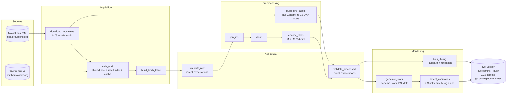
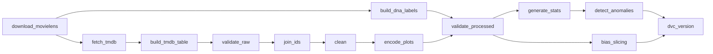
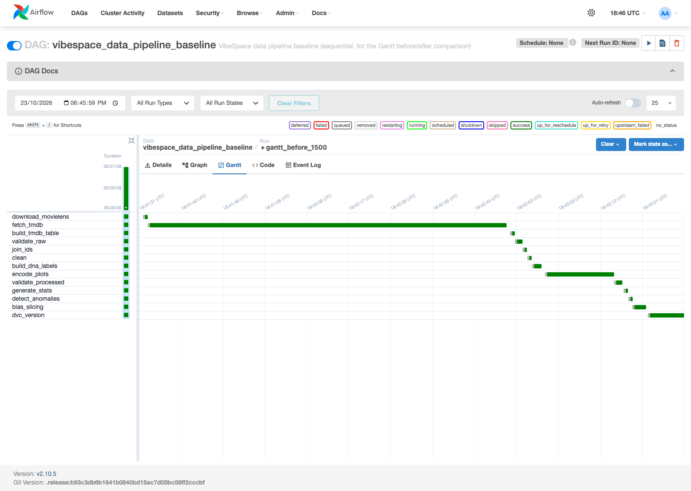
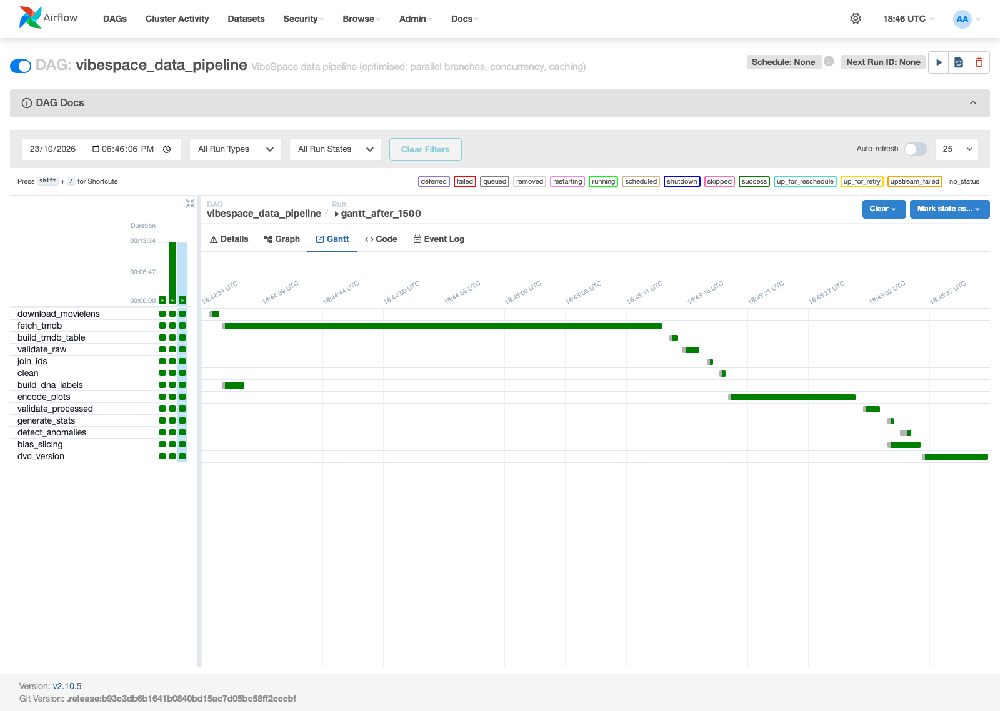

# VibeSpace data pipeline

This folder is the **data pipeline** of VibeSpace, our MLOps course project. It downloads MovieLens 25M and
TMDB metadata, then cleans, validates, labels, encodes, checks for bias and versions the results. It is
orchestrated with Airflow, validated with Great Expectations and versioned with DVC.

**Contents**

1. [Overview](#1-overview)
2. [Architecture](#2-architecture)
3. [Folder structure](#3-folder-structure)
4. [Prerequisites](#4-prerequisites)
5. [Setup](#5-setup)
6. [Data sources and acquisition](#6-data-sources-and-acquisition)
7. [Preprocessing and feature engineering](#7-preprocessing-and-feature-engineering)
8. [Schema, statistics and validation](#8-schema-statistics-and-validation)
9. [Anomaly detection and alerts](#9-anomaly-detection-and-alerts)
10. [Airflow orchestration](#10-airflow-orchestration)
11. [Running without Airflow](#11-running-without-airflow)
12. [Data versioning with DVC](#12-data-versioning-with-dvc)
13. [Testing](#13-testing)
14. [Logging and error handling](#14-logging-and-error-handling)
15. [Pipeline optimization (Gantt)](#15-pipeline-optimization-gantt)
16. [Bias detection and mitigation](#16-bias-detection-and-mitigation)
17. [Reproducibility](#17-reproducibility)
18. [Requirements checklist](#18-requirements-checklist)
19. [Troubleshooting](#19-troubleshooting)
20. [Known limitations and next steps](#20-known-limitations-and-next-steps)

---

## 1. Overview

VibeSpace is a **mood-aware movie recommender**. A user says how they feel and how they want to feel, then
swipes through movie cards. Recommendations are driven by each film's **Movie DNA**: 12 emotional and
stylistic scores. The first model to train is the Movie DNA model, which predicts these scores from a
film's plot and metadata. This pipeline builds everything that model needs:

| Output (under `data/processed/`) | What it is | Why it is needed |
|---|---|---|
| `movies_clean.parquet` | Clean catalog of MovieLens + TMDB metadata (title, overview, runtime, language, genres, keywords, release date, votes, poster, trailer) with slice columns and data-quality flags | Model inputs and the app's movie cards |
| `movie_dna_labels.parquet` | 12 **Movie DNA** labels per movie (percentiles in [0, 1]), built from the MovieLens Tag Genome | Training targets for the Movie DNA model |
| `plot_embeddings.npy` + `plot_embeddings_index.parquet` | 384-dim `all-MiniLM-L6-v2` embedding of every plot overview, plus the row → `movieId` index | Text features for the Movie DNA model |

The 12 dimensions are `energy, intensity, pace, humor, darkness, hopefulness, emotional_intensity, romance,
suspense, complexity, realism, inspiration`.

**The Tag Genome is only used to build labels. It is never a model input.** It exists only for well-known
MovieLens films, while the model has to score any new film from its plot and metadata. No LLMs are used
anywhere. The only pretrained model is the small local text encoder.

Results of the full TMDB `genome` stage (the run the committed reports come from):
- 13,816 Tag Genome movies, of which 13,666 joined to TMDB (match rate 98.9%) and passed cleaning.
- 13,816 DNA label rows and 13,666 × 384 plot embeddings.
- 8 Great Expectations suites with 103 expectations (including the checks of every column the model
  pipeline reads), all passing on these outputs.
- 0 critical and 0 warning anomalies.

---

## 2. Architecture



Every box is one function in `scripts/` and one Airflow task. Airflow (LocalExecutor + Postgres in Docker)
runs them in this order. The same functions run without Airflow through `scripts/run_pipeline.py` or
`dvc repro`.

---

## 3. Folder structure

```
VibeSpace/                          # repository root (DVC is initialised here: .dvc/, .dvcignore)
└── Data-Pipeline/
    ├── dags/
    │   └── data_pipeline_dag.py    # the two Airflow DAGs (optimised + sequential baseline)
    ├── data/                       # all data, git-ignored and tracked by DVC (raw/, interim/, processed/, metrics/, cache/);
    │                               #   sample runs write to data/sample/ (git- and DVC-ignored, never versioned)
    ├── scripts/                    # one module per step (pure functions) + a thin task layer
    │   ├── config.py               # settings from env / .env, validated; secrets never logged
    │   ├── acquire_movielens.py    # download, MD5, safe unzip, header checks, manifest
    │   ├── acquire_tmdb.py         # TMDB client: thread pool, rate limiter, retries, cache, stages
    │   ├── build_tmdb_table.py     # flatten cached JSON, quarantine unreadable files
    │   ├── join_ids.py             # MovieLens <-> TMDB join, quarantine reasons, match rate
    │   ├── clean.py                # genres, languages, slice columns, flags, quarantine
    │   ├── build_dna_labels.py     # Tag Genome -> 12 DNA percentile labels
    │   ├── dna_sanity_report.py    # top/bottom 10 per dimension + automatic checks
    │   ├── encode_plots.py         # MiniLM plot embeddings, batched and cached
    │   ├── gx_suites.py            # Great Expectations suite definitions
    │   ├── validate.py             # runs the GX suites, writes results, fails on errors
    │   ├── generate_stats.py       # schema + statistics per run, drift (PSI) vs previous run
    │   ├── anomalies.py            # anomaly checks with severities
    │   ├── alerts.py               # Slack / email / log-file alerts, Airflow failure callback
    │   ├── bias_slicing.py         # Fairlearn slicing, mitigation, bias report
    │   ├── dvc_versioning.py       # dvc commit / push / status (last DAG task)
    │   ├── tasks.py                # Airflow task layer (params -> config -> step)
    │   ├── run_pipeline.py         # CLI: run any step without Airflow
    │   ├── gantt.py                # Gantt charts from the Airflow REST API
    │   ├── io_utils.py             # atomic parquet / JSON / numpy / text writes, CSV helpers
    │   ├── logging_utils.py        # logging setup, START / DONE / FAILED step logging
    │   └── exceptions.py           # one exception class per failure type
    ├── tests/                      # pytest unit, integration and DAG tests (offline)
    │   ├── fixtures/               # tiny MovieLens layout + fake TMDB JSON + build_fixtures.py
    │   └── helpers.py, conftest.py # fake HTTP sessions, fake encoder, temp configs
    ├── logs/                       # pipeline.log, alerts.log, Airflow task logs (git-ignored)
    ├── configs/
    │   └── movie_dna_mapping_v1.yaml   # Tag Genome tag -> DNA dimension mapping (v1, reviewed by the team)
    ├── gx/expectations/            # the GX suites exported as JSON
    ├── reports/                    # dna_sanity_report.md, bias_report.md (full genome run);
    │                               #   sample runs write to reports/sample/ (git-ignored)
    ├── docs/                       # optimization.md, Gantt charts, requirements_checklist.md
    ├── dvc.yaml                    # 12 DVC stages, one per pipeline step
    ├── dvc.lock                    # hashes of the last versioned outputs
    ├── Dockerfile                  # Airflow 2.10.5 + requirements.txt, CPU-only torch
    ├── docker-compose.yaml         # Postgres, airflow-init, scheduler, webserver
    ├── requirements.txt            # runtime dependencies
    ├── requirements-dev.txt        # + Airflow, pytest, pytest-cov, ruff (local venv)
    ├── pytest.ini, ruff.toml       # test and lint settings
    ├── .env.example                # every setting, copy to .env
    └── README.md                   # this file
```

---

## 4. Prerequisites

| Requirement | Notes |
|---|---|
| macOS or Linux | Windows works through WSL2. |
| Python **3.11** | `python3.11 --version` |
| Git | to clone the repository |
| Docker Desktop | give it **8 GB of memory** (Settings → Resources), needed only for Airflow |
| DVC | installed by `requirements.txt` (`dvc==3.59.1`), so no separate install is needed |
| Disk | about 6 GB free for data and the DVC cache |
| Google Cloud CLI | optional, only to `dvc pull` from the team bucket (section 12) |
| TMDB API key | free; see below |

**Getting a TMDB key:**
1. Create a free account at <https://www.themoviedb.org>.
2. Open *Settings → API → Request an API key* and choose *Developer*.
3. Copy either the **API key (v3)** or the **API Read Access Token (v4)**. Both work, and the client detects
   which one it got.

---

## 5. Setup

```bash
git clone https://github.com/nikhilsk98/VibeSpace.git
cd VibeSpace/Data-Pipeline

cp .env.example .env              # then edit .env and paste your TMDB_API_KEY
echo "AIRFLOW_UID=$(id -u)" >> .env   # Docker writes files as your user

python3.11 -m venv .venv
.venv/bin/pip install --upgrade pip
.venv/bin/pip install -r requirements-dev.txt \
    --constraint https://raw.githubusercontent.com/apache/airflow/constraints-2.10.5/constraints-3.11.txt
```

`requirements-dev.txt` includes `requirements.txt` plus Airflow, pytest, pytest-cov and ruff. Always use the
Airflow constraints file, so the local venv resolves to the same versions as the Airflow image. Here is why
some versions are pinned:
- Airflow 2.10.5 pins pandas 2.1.4, numpy 1.26.4, pyarrow 16.1, SQLAlchemy 1.4 and sympy 1.13.3.
- torch ≤ 2.6 requires sympy 1.13.1, so torch is pinned to 2.7.1. The image installs the CPU-only build.
- great_expectations 1.3.14 works with pandas 2.1 and SQLAlchemy 1.4.
- fairlearn 0.12.0 works with scikit-learn 1.5.2.
- sentence-transformers 3.4.1 works with transformers 4.48.3.

### `.env` variables

`.env` is git-ignored and never committed. Secrets are masked whenever the config is logged.

| Variable | Default | Meaning |
|---|---|---|
| `TMDB_API_KEY` | (none, required) | TMDB v3 API key (32 chars) or v4 read access token (starts with `eyJ`) |
| `TMDB_STAGE` | `genome` | which movies to fetch: `genome`, `rest` or `all` (section 6) |
| `SAMPLE_SIZE` | empty = all | run on N randomly chosen movies (reproducible, seed 42) |
| `TMDB_MAX_WORKERS` | `8` | TMDB thread-pool size (CLI runs; the DAGs set their own, see section 10) |
| `TMDB_RATE_LIMIT` | `20` | TMDB requests per second shared by all workers (CLI runs) |
| `MIN_MATCH_RATE` | `0.90` | minimum MovieLens → TMDB match rate; below it the join fails |
| `SLACK_WEBHOOK_URL` | empty | Slack incoming webhook for alerts |
| `ALERT_EMAIL` | empty | alert recipient (needs `SMTP_HOST`) |
| `SMTP_HOST`, `SMTP_PORT`, `SMTP_USER`, `SMTP_PASSWORD`, `SMTP_SENDER`, `SMTP_USE_TLS` | empty, `587`, empty, empty, empty, `true` | SMTP server for email alerts |
| `AIRFLOW_UID` | `50000` | your user id (`id -u`) so files written by Airflow belong to you |
| `_AIRFLOW_WWW_USER_USERNAME`, `_AIRFLOW_WWW_USER_PASSWORD` | `airflow`, `airflow` | Airflow web login created by `airflow-init` |
| `VIBESPACE_SCHEDULE` | empty = manual | cron schedule for the optimised DAG, e.g. `0 3 * * 1` |

These optional settings are read by `scripts/config.py` but are not listed in `.env.example`:
- `TMDB_TIMEOUT` (10 s), `TMDB_MAX_RETRIES` (5) and `TMDB_MAX_FAILURE_RATE` (0.05).
- `ENCODER_BATCH_SIZE` (64 for CLI runs), `USE_CACHE` (`true`) and `RANDOM_SEED` (42).
- `DVC_PUSH` (`true`).
- `VIBESPACE_DATA_DIR`, `VIBESPACE_LOGS_DIR` and `VIBESPACE_REPORTS_DIR`, to move data, logs or reports
  elsewhere.

---

## 6. Data sources and acquisition

### MovieLens 25M (`scripts/acquire_movielens.py`)

- **Source:** <https://files.grouplens.org/datasets/movielens/ml-25m.zip> (about 250 MB), with the published
  checksum at `ml-25m.zip.md5` (MD5 `6b51fb2759a8657d3bfcbfc42b592ada`).
- **Download:** streamed to a `.part` file with retries and exponential backoff on network errors and
  HTTP 429/5xx. A size check against `Content-Length` catches truncated downloads. The file is renamed only
  when complete.
- **Checks:**
  - The MD5 is verified. A mismatch deletes the zip and raises `ChecksumMismatchError`.
  - Corrupt zips and members with path traversal (`../`), absolute paths or symlinks are rejected
    (`CorruptArchiveError`).
  - The header of every CSV is checked (`SchemaError`).
- **Manifest:** `data/raw/movielens/manifest.json` records the URL, MD5, time and file sizes. If the
  verified data is already present, the step is skipped.
- **Files used:**

  | File | Used for |
  |---|---|
  | `movies.csv` | titles and genres |
  | `links.csv` | `movieId` → `tmdbId` |
  | `genome-scores.csv` | 15M rows of tag relevance, used only for DNA labels |
  | `genome-tags.csv` | 1,128 tag names |

  `ratings.csv` and `tags.csv` are header-checked and versioned for the later recommendation models.

### TMDB API (`scripts/acquire_tmdb.py`, `scripts/build_tmdb_table.py`)

- **Endpoint:** `GET /3/movie/{tmdb_id}?append_to_response=keywords,videos`. That is one request per movie,
  which returns details, keywords and trailers together.
- **Stages** (`TMDB_STAGE` or the DAG param `tmdb_stage`):
  - `genome`: the 13,816 MovieLens movies that have Tag Genome scores. These are the only movies that get
    DNA labels.
  - `rest`: the other ≈48,600 MovieLens movies. Catalog only, slow (≈48k requests).
  - `all`: both.
- **Rate limiting:** one thread-safe limiter is shared by all workers. Defaults are 40 req/s in the
  optimised DAG (TMDB allows about 50 per IP) and 20 req/s for CLI runs.
- **Retries:** timeouts, connection errors and 5xx are retried up to 5 times with exponential backoff
  (1, 2, 4 … s, capped at 60 s).
- **HTTP 429:** the client waits for `Retry-After`, or backs off if the header is missing.
- **HTTP 404:** cached as "not found" and never requested again.
- **HTTP 401:** raises `TMDBAuthError` and stops the whole run at once (no Airflow retries).
- **Other 4xx:** the movie counts as failed and is not retried. If more than 5% of requests fail, the step
  fails with `FailureRateExceededError`.
- **Caching and resume:** one JSON file per movie in `data/raw/tmdb/movies/`, so an interrupted run resumes
  where it stopped. Corrupt cache files are re-fetched. `use_cache=false` re-fetches everything.
- **Table:** `build_tmdb_table` flattens the cache into `data/interim/tmdb_movies.parquet` with these
  fields:
  - title, overview, runtime, original language, genres, keywords
  - production countries, release date, popularity, vote count / average
  - poster path, adult flag, best YouTube trailer key
- **Quarantine:** unreadable files move to `data/interim/tmdb_quarantine_files/` and are listed in
  `tmdb_quarantine.parquet`.
- **Full genome run:** 13,816 movies selected, 13 without a `tmdbId`, 13,798 requested, 132 not found on
  TMDB, 0 failed.

### Licensing and attribution

* **MovieLens 25M**: F. Maxwell Harper and Joseph A. Konstan. 2015. *The MovieLens Datasets: History and
  Context.* ACM TiiS 5(4). Provided by GroupLens Research, University of Minnesota, under their usage
  license (research and education, no redistribution). The data is therefore downloaded, never committed.
* **TMDB**: this product uses the TMDB API but is not endorsed or certified by TMDB. Metadata, posters and
  trailer references come from <https://www.themoviedb.org>.
* **all-MiniLM-L6-v2**: sentence-transformers model, Apache 2.0.

---

## 7. Preprocessing and feature engineering

### ID join (`scripts/join_ids.py`)

MovieLens movies are joined to the TMDB table through `links.csv`. Movies that cannot be joined go to
`data/interim/join_quarantine.parquet` with a reason:

| Reason | Meaning | Full genome run |
|---|---|---|
| `no_tmdb_id` | `links.csv` has no TMDB id | 13 |
| `duplicate_tmdb_id` | two MovieLens ids point to one TMDB id; the lowest `movieId` is kept | 5 |
| `tmdb_missing` | TMDB returned 404 / no data | 132 |

The release year parsed from the MovieLens title (`Toy Story (1995)`) is compared with TMDB's year. A
difference of more than 2 years sets `year_mismatch`, which is flagged but not removed (20 movies). If the
match rate falls below `MIN_MATCH_RATE` (0.90), the step fails with `MatchRateError`. In the full run,
13,666 / 13,816 = **98.9%** matched. Stats are written to `data/interim/join_stats.json`.

### Cleaning (`scripts/clean.py`)

- **Genres:** MovieLens and TMDB genres are merged into one vocabulary of 20 canonical genres
  (`science_fiction`, `tv_movie`, …). `primary_genre` is the first one.
- **Languages:**
  - Codes are normalised to ISO 639-1. Legacy codes are mapped (`cn→zh`, `iw→he`, `in→id`, `ji→yi`,
    `mo→ro`, `sh→sr`), and anything invalid becomes `unknown`.
  - `language_group` is `english`, `hindi`, `indian_regional` (ta, te, ml, kn, bn, mr, pa, gu, or, as),
    `other_international` or `unknown`.
- **Slice columns** (also used for bias analysis):
  - `language_group` (above).
  - `era`: `pre_1980`, `1980_1999`, `2000_plus` or `unknown`.
  - `popularity_bucket`, by vote-count rank: top 20% `high`, bottom 40% `low`, the rest `mid`.
  - `primary_genre` (above).
- **Flags** are added as columns, never silently fixed. Counts from the full run:

  | Flag | Full run |
  |---|---|
  | `flag_missing_overview` | 0 |
  | `flag_short_overview` (< 40 chars) | 0 |
  | `flag_missing_runtime` (missing or ≤ 0) | 4 |
  | `flag_runtime_outlier` (> 400 min) | 3 |
  | `flag_invalid_year` (before 1874 or after next year) | 0 |
  | `flag_missing_year` | 0 |
  | `flag_unknown_language` | 4 |
  | `flag_year_mismatch` | 20 |

- **Quarantine** (`data/processed/clean_quarantine.parquet`): `duplicate_movie_id`, `missing_title` and
  `adult_content`. There were 0 in the full run.

### Movie DNA labels from the Tag Genome (`scripts/build_dna_labels.py`)

The Tag Genome gives every well-known MovieLens film a relevance score in [0, 1] for 1,128 tags. The
mapping file [`configs/movie_dna_mapping_v1.yaml`](configs/movie_dna_mapping_v1.yaml) (**v1, reviewed by the
team**) assigns each DNA dimension:
- 3–6 **positive** tags, which raise the score;
- optional **inverse** tags, which lower it.

For example, `energy` has the positive tags `action packed`, `explosions`, `fight scenes`, `car chase` and
`good action`, and the inverse tags `meditative` and `reflective`. 78 tags are used across the 12
dimensions.

Rules enforced on every run:
- Every tag must exist exactly (case-sensitive) in `genome-tags.csv`. An unknown tag raises `MappingError`
  and stops the pipeline.
- A tag may not be both positive and inverse.
- A tag may appear in two dimensions only if it is listed under `allowed_shared_tags` with a reason.

**Method:**
1. The raw score is `mean(relevance of positive tags, 1 − relevance of inverse tags)`.
2. The raw score is converted to a percentile across all labelled movies, so every dimension is uniform on
   [0, 1] and comparable across dimensions.
3. Only the needed tag rows of the 15M-row `genome-scores.csv` are read (streamed with pyarrow).

**Worked example:** *Mad Max: Fury Road (2015)*, dimension `energy`, using the real Tag Genome values:

| Tag | Type | Relevance | Contribution |
|---|---|---|---|
| action packed | positive | 0.964 | 0.964 |
| explosions | positive | 0.848 | 0.848 |
| fight scenes | positive | 0.735 | 0.735 |
| car chase | positive | 0.806 | 0.806 |
| good action | positive | 0.901 | 0.901 |
| meditative | inverse | 0.175 | 1 − 0.175 = 0.825 |
| reflective | inverse | 0.405 | 1 − 0.405 = 0.595 |

The raw score is 5.674 / 7 = **0.8105**. That ranks at the **0.992** percentile, so the film has higher
energy than 99.2% of the 13,816 labelled films.

**Output:**
- `data/processed/movie_dna_labels.parquet`: `movieId`, the 12 percentile columns, the 12 `*_raw` columns
  and `mapping_version`.
- `dna_labels_summary.json`: summary counts for the run.

**Sanity report** ([`reports/dna_sanity_report.md`](reports/dna_sanity_report.md), regenerated on every
full run) lists the top 10 and bottom 10 films per dimension, so a person can judge the labels. It also
runs automatic checks:
- genre lift of the top 100 films;
- a flat-distribution check (raw standard deviation);
- highly correlated dimension pairs.

All 12 dimensions pass, with 0 flagged.

### Plot encoding (`scripts/encode_plots.py`)

- Overviews are encoded with `sentence-transformers/all-MiniLM-L6-v2` on CPU, in batches (128 in the
  optimised DAG), as L2-normalised 384-dim vectors.
- Movies without an overview are skipped and logged. The embedding index maps every row to its `movieId`.
- Vectors are cached per (`movieId`, overview hash, encoder version), so only new or changed overviews are
  encoded again.
- The encoder weights (≈90 MB) download on first use into `Data-Pipeline/.cache/huggingface/`
  (git-ignored).

---

## 8. Schema, statistics and validation

### Great Expectations (`scripts/gx_suites.py`, `scripts/validate.py`)

- The suites are declared in code with GX Core 1.3.14 and exported to
  [`gx/expectations/*.json`](gx/expectations/). They run on in-memory DataFrames.
- Results are written to `data/metrics/validation_raw.json` and `validation_processed.json`.
- A failed suite raises `ValidationFailedError`. The task then fails without retries, and downstream tasks
  do not run.

| Suite | Step | Expectations | Checks |
|---|---|---|---|
| `raw_movielens_movies` | validate_raw | 7 | at least 1 row; `movieId`, `title`, `genres` exist; `movieId` not null and unique; `title` not null |
| `raw_movielens_links` | validate_raw | 5 | at least 1 row; `movieId` not null and unique; `tmdbId` ≥ 98% non-null and ≥ 1 |
| `raw_genome_tags` | validate_raw | 5 | at least 1 row; `tagId` and `tag` not null and unique |
| `raw_tmdb_movies` | validate_raw | 8 | at least 1 row; `tmdb_id` not null and unique; runtime 0–1000 (99%); vote count ≥ 0; vote average 0–10; language `^[a-z]{2}$` (99%); release date `YYYY-MM-DD` (95%) |
| `join_quality` | validate_processed | 1 | match rate between `MIN_MATCH_RATE` and 1 |
| `processed_catalog` | validate_processed | 39 | at least 1 row; `movieId` / `tmdbId` not null and unique; `title` not null; runtime 1–400 (95%); year 1874 to next year; language format; `language_group`, `era`, `popularity_bucket` and `primary_genre` in their allowed sets; **model inputs:** every movie has ≥ 1 genre and all genres are in the canonical vocabulary (`genre_count`, `genres_known`); `popularity` 0–10,000, `vote_count` 0–10,000,000 and `vote_average` 0–10, all not null; the 6 `flag_*` columns the model uses exist, are not null and are boolean |
| `processed_dna_labels` | validate_processed | 28 | at least 1 row; `movieId` not null and unique; `mapping_version` set; each of the 12 dimensions not null and in [0, 1] |
| `processed_embeddings` | validate_processed | 10 | at least 1 row; `movieId` not null and unique; dim = 384; all values finite; norm 0.99–1.01; every embedding linked to a catalog movie; index `row` is 0..n−1 in matrix order (`row_in_order`); `encoder` recorded and equal to the configured encoder |

The full genome outputs pass all **8 suites and 103 expectations**. `genres` is a list column, so the
catalog suite checks two derived columns instead (`genre_count`, `genres_known`, built in
`validate.catalog_frame`); the embedding suite checks the per-row facts built in `validate.embedding_frame`.
The flag columns are the ones in `gx_suites.MODEL_FLAG_COLUMNS`, which mirror
`Model-Pipeline/configs/model_config.yaml` (`features.flag_columns`).

### Per-run statistics and drift (`scripts/generate_stats.py`)

Every run writes `data/metrics/stats/<profile>/stats_<run_id>.json` and updates `latest.json` for its
profile. The profile is stage + sample size, for example `genome_all` or `genome_n200`, so sample runs are
never compared with full runs. Each stats file contains:
- the schema (column → dtype);
- per-column statistics: count, null rate, min / max / mean / std and 1/25/50/75/99% quantiles for
  numbers, and the 10 most frequent values for text;
- row counts, slice counts and coverage (movies with labels and with embeddings).

Each run is compared with the previous run of the same profile. The drift section records:
- schema changes (added or removed columns, changed dtypes);
- null-rate jumps;
- row-count change;
- **PSI** of each slice distribution: ≥ 0.10 is a warning, ≥ 0.25 is critical.

---

## 9. Anomaly detection and alerts

`scripts/anomalies.py` runs after `generate_stats` and writes `data/metrics/anomalies_current.json` plus a
history file per run. Each anomaly has a severity: `info`, `warning` or `critical`.

| Check | Examples | Severity |
|---|---|---|
| Missing values | null rate of `title` (any null is critical), `overview` / `runtime` (warning 5%, critical 20%), `release_date` / `vote_count` (2% / 10%) | warning / critical |
| Outliers | runtimes of 0, runtimes > 400 min, runtimes above the 3×IQR fence | info, or warning above 1% / 2% of rows |
| Invalid formats | invalid language codes (critical, blocking), > 2% unknown languages (warning), malformed release dates | info / warning / critical |
| Schema violations | missing columns or wrong dtypes against the expected catalog schema | critical (blocking) |
| Failed GX suites | any failed suite in the validation results | critical (blocking) |
| Drift | PSI of slices, null-rate rise > 5 points, row count drop > 20%, a column that disappeared | warning / critical |
| Join quality | match rate below the minimum (critical), close to it (warning), share of year mismatches | info / warning / critical |

- At least one `warning` sends an alert.
- A *blocking* `critical` anomaly fails the task (`AnomalyError`, no retries).
- Full genome run: **0 critical, 0 warning, 4 info**:
  - 4 runtimes of 0;
  - 3 runtimes above 400 min;
  - 113 runtimes above the 3×IQR fence of 180 min;
  - 20 release-year mismatches (0.1%).

### Alert channels (`scripts/alerts.py`)

| Channel | How to enable |
|---|---|
| Log file (always on) | every alert is appended as one JSON line to `logs/alerts.log` |
| Slack | set `SLACK_WEBHOOK_URL` (Slack → *Apps* → *Incoming Webhooks* → *Add to channel*) |
| Email | set `SMTP_HOST`, `SMTP_PORT`, `SMTP_USER`, `SMTP_PASSWORD`, `SMTP_SENDER`, `ALERT_EMAIL` (with Gmail, use an app password and `smtp.gmail.com:587`) |

- Every Airflow task has `on_failure_callback`, which sends an alert with the DAG, task, run id, try number,
  error and log URL.
- `detect_anomalies` sends an alert whenever it finds warnings.
- Alerting never crashes the pipeline: a broken channel is logged and the other channels still run.

---

## 10. Airflow orchestration

`dags/data_pipeline_dag.py` builds two DAGs from one factory:

| DAG | Tags | Layout | TMDB workers / rate | Encoder batch | Cache |
|---|---|---|---|---|---|
| `vibespace_data_pipeline` | `vibespace`, `data-pipeline`, `parallel` | parallel branches (below) | 8 / 40 req/s | 128 | on |
| `vibespace_data_pipeline_baseline` | `vibespace`, `data-pipeline`, `sequential` | strict chain of the 13 tasks | 1 / 20 req/s | 8 | off |

The baseline exists only for the Gantt before/after comparison (section 15).



- **Settings for every task:**
  - 2 retries, starting 30 s apart with exponential backoff (at most 10 min);
  - a 3 h execution timeout;
  - `on_failure_callback` (alert);
  - `doc_md` describing the task.
- **Errors a retry cannot fix:** `TMDBAuthError`, `MappingError`, `ValidationFailedError`, `ConfigError`
  and `AnomalyError` are turned into `AirflowFailException`, so the task fails at once.
- **DAG settings:** `catchup=False` and `max_active_runs=1`. The optimised DAG is manual unless
  `VIBESPACE_SCHEDULE` is set.
- **Params** (*Trigger DAG w/ config*):

| Param | Default (optimised) | Meaning |
|---|---|---|
| `tmdb_stage` | `genome` (or `TMDB_STAGE`) | `genome`, `rest` or `all` |
| `sample_size` | empty | run on N movies for a quick end-to-end check; outputs go to `data/sample/` and are never versioned (section 11) |
| `use_cache` | `true` | reuse cached TMDB responses and embeddings |
| `tmdb_max_workers` | `8` | TMDB thread-pool size |
| `tmdb_rate_limit` | `40` | TMDB requests per second |
| `encoder_batch_size` | `128` | plot-encoding batch size |

### Start Airflow

```bash
cd VibeSpace/Data-Pipeline
docker compose build              # Airflow 2.10.5 + requirements.txt, CPU-only torch (multi-arch, works on Apple Silicon)
docker compose up airflow-init    # migrates the DB and creates the web user
docker compose up -d              # postgres, scheduler, webserver
open http://localhost:8080        # login airflow / airflow (set in .env)
```

The whole repository is mounted at `/opt/vibespace`, and `PYTHONPATH` points to `Data-Pipeline/`. The DAG
therefore imports `scripts` directly, and DVC inside the containers sees the repository root. Stop
everything with `docker compose down`.

### Trigger a run

- **UI:** open `vibespace_data_pipeline`, choose *Trigger DAG w/ config*, set the params and trigger.
- **CLI:**

```bash
# quick end-to-end check on 200 movies.
# Pause the DAG first, or the running scheduler also picks up the tasks of `dags test`.
docker compose exec airflow-scheduler airflow dags pause vibespace_data_pipeline
docker compose exec airflow-scheduler airflow dags test vibespace_data_pipeline -c '{"sample_size": 200}'
docker compose exec airflow-scheduler airflow dags unpause vibespace_data_pipeline

# full genome stage
docker compose exec airflow-scheduler airflow dags trigger vibespace_data_pipeline -c '{"tmdb_stage": "genome"}'
```

**Screenshots:** the Airflow Gantt views of the baseline and optimised runs are in section 15
([`docs/gantt_before.png`](docs/gantt_before.png), [`docs/gantt_after.png`](docs/gantt_after.png)).

---

## 11. Running without Airflow

`scripts/run_pipeline.py` runs the same task functions in DAG order, using the local `.venv` and `.env`:

```bash
.venv/bin/python -m scripts.run_pipeline all --sample-size 200 --skip dvc_version   # quick end-to-end check
.venv/bin/python -m scripts.run_pipeline clean                                     # one step
.venv/bin/python -m scripts.run_pipeline join_ids clean encode_plots               # several steps
.venv/bin/python -m scripts.run_pipeline all --skip dvc_version                    # full genome stage
.venv/bin/python -m scripts.run_pipeline all --stage rest                          # TMDB stage "rest" (≈48k requests)
.venv/bin/python -m scripts.run_pipeline all --no-cache --run-id my_run            # ignore caches, name the run
```

The `--sample-size N` option:
- picks a reproducible random sample of N movies (seed 42);
- keeps its statistics under a separate profile, for example `genome_n200`;
- writes its interim, processed and metrics outputs to `data/sample/` (same layout as `data/`: `interim/`,
  `processed/`, `metrics/`), which is git- and DVC-ignored. The versioned outputs in `data/interim/`,
  `data/processed/` and `data/metrics/` are never touched. Raw inputs (`data/raw/`) and caches
  (`data/cache/`) are shared, so a sample of cached movies makes no TMDB requests;
- writes its reports to `reports/sample/`, which is git-ignored. The committed full-run reports in
  `reports/` are never overwritten;
- is never versioned: `dvc_version` logs "DVC versioning skipped" and runs neither `dvc commit` nor
  `dvc push`, also inside Airflow (`airflow dags test … -c '{"sample_size": 200}'`) and with `DVC_PUSH=true`.

To train the model on a sample, point it at the sample outputs (the hash check does not apply to them):
`VIBESPACE_MODEL_PROCESSED_DIR=../Data-Pipeline/data/sample/processed .venv/bin/python -m vibespace_model.cli
run-all --skip-hash-check --sample-size 200` from `Model-Pipeline/`.

`--sample-size 0` means all movies. The CLI prints one JSON summary per step and exits non-zero on failure.

The 200-movie sample takes about 30 s with a warm MovieLens download. On a fresh machine add the ≈250 MB
MovieLens download and the ≈90 MB encoder download.

---

## 12. Data versioning with DVC

- **Git** holds the code, the configs, [`dvc.yaml`](dvc.yaml) and the DVC pointer file
  [`dvc.lock`](dvc.lock).
- **DVC** holds the data: everything under `data/` (raw, interim, processed, metrics, caches).
- DVC is initialised at the repository root (`.dvc/`, `.dvcignore`). `data/` is git-ignored.

**Stages:** `dvc.yaml` declares 12 stages, one per pipeline step (`download_movielens` … `bias_slicing`).
Each stage lists:
- its command (`python -m scripts.run_pipeline <step>`);
- its dependencies: its script and its upstream files;
- its outputs.

Caches and history folders use `persist: true`. The two reports are outputs with `cache: false`, so Git
keeps them and DVC records their hashes.

**In Airflow:** the last task, `dvc_version`, runs `dvc commit --force` (records hashes in `dvc.lock`), then
`dvc push`, then `dvc status`. For sample runs it does nothing (section 11), so only full runs are ever
versioned.

**`dvc status` after a rerun:** stages can be listed as changed even when the data is identical, because some
outputs (the step summaries in `data/interim/` and `data/processed/`, the validation, statistics, anomaly and
bias files in `data/metrics/`, and the two reports) contain timestamps, run IDs or durations. The four
model inputs (`movies_clean.parquet`, `movie_dna_labels.parquet`, `plot_embeddings.npy`,
`plot_embeddings_index.parquet`) are byte-identical on a cached rerun; only those are hash-checked by the
model pipeline.

**Re-encoding embeddings from scratch:** encoding the plots again without the embedding cache
(`data/cache/embeddings/`) gives the same vectors up to float noise (max absolute difference ≈ 3e-7, cosine
similarity ≥ 0.9999998), but not the same bytes, so `plot_embeddings.npy` gets a new MD5 and the model
pipeline's hash check correctly refuses it. The supported paths are the DVC-versioned embedding cache
(`dvc pull`, then a normal run reuses every vector), or a deliberate re-encode followed by `dvc commit`
(and `dvc push`) so `dvc.lock` records the new file.

```bash
dvc status        # do the workspace files match dvc.lock?
dvc repro         # reproduce all stages without Airflow (only changed stages run)
dvc dag           # show the stage graph
dvc push          # upload data to the remote
dvc pull          # download data for the current dvc.lock
git add dvc.lock && git commit -m "Version data"    # record a data version in Git
git checkout <commit> && dvc pull                    # restore the data of an older version
```

### The remote is a private GCS bucket

`.dvc/config` sets the default remote `gcs` to `gs://vibespace-dvc-nsk/dvc`, a **private** Google Cloud
Storage bucket (project `vibespace-mlops`, region `us-east1`, uniform bucket-level access, public access
prevention enforced). It holds every data version the pipeline has pushed so far. Nobody can read it without
being granted access, and no credentials are stored in the repository.

The old local remote `localstore` (`../dvc-storage`) is still listed as a non-default entry. The local copy
it pointed to has been removed (every object is in the bucket), so use only `gcs`; `dvc pull` and `dvc push`
never use `localstore` unless you pass `-r localstore`.

**Access for a teammate (one-time setup):**

1. The bucket owner grants your Google account `roles/storage.objectUser` on the bucket only:
   `gcloud storage buckets add-iam-policy-binding gs://vibespace-dvc-nsk --member=user:EMAIL --role=roles/storage.objectUser`
2. Install the [Google Cloud CLI](https://cloud.google.com/sdk/docs/install) and log in for client
   libraries (DVC uses these credentials):

```bash
gcloud auth application-default login     # pick the Google account that was granted access
.venv/bin/pip install "dvc[gs]==3.59.1" \
    --constraint https://raw.githubusercontent.com/apache/airflow/constraints-2.10.5/constraints-3.11.txt
                                          # adds the GCS plugin to the venv from section 5
dvc pull                                  # downloads all outputs for the current dvc.lock
```

**Without access** (for example a grader): `dvc pull` fails with a permission error, which is expected.
Reproduce all data by running the pipeline instead (section 17), which downloads everything again from
MovieLens and TMDB. No access to our remote is needed.

**Airflow in Docker:** the image does not include the GCS plugin or any Google credentials, so the
`dvc_version` task cannot push to the bucket from inside the containers. Set `DVC_PUSH=false` in `.env` for
Airflow runs; the task still runs `dvc commit` and `dvc status`. Then run `dvc push` on the host.

---

## 13. Testing

```bash
.venv/bin/python -m pytest                                 # all tests (offline)
.venv/bin/python -m pytest --cov=scripts --cov=dags        # with coverage
.venv/bin/python -m pytest -m integration                  # end-to-end runs on fixture data
.venv/bin/python -m pytest tests/test_clean.py -k flags    # one file / one test
.venv/bin/ruff check .                                      # lint: PEP 8 style, pyflakes, imports, bugbear, naming, security
.venv/bin/python -m tests.fixtures.build_fixtures           # regenerate the fixture files (no Git diff)
```

**Tests never touch the network.** They use:
- fake HTTP sessions;
- fake TMDB responses (`tests/fixtures/tmdb/`);
- a tiny MovieLens layout (`tests/fixtures/movielens/`: 60 movies, the real mapping tags);
- a deterministic fake text encoder.

| Test file | Tests | What it covers |
|---|---|---|
| `test_acquire_movielens.py` | 18 | MD5 parsing, download retries / give-up / truncation, checksum mismatch, corrupt zip, path traversal, symlinks, missing files / columns, skip-if-verified, tampering |
| `test_acquire_tmdb.py` | 28 | v3 key vs v4 token, missing key, 404 caching, 401 stop, 429 with / without `Retry-After`, 5xx and timeouts, retries exhausted, other 4xx, rate limiter (spacing, thread safety), resume from cache, corrupt cache, failure-rate gate, stages and reproducible samples |
| `test_build_tmdb_table.py` | 7 | flattening, missing fields, trailer choice, keywords, quarantine of bad files, empty input |
| `test_join_ids.py` | 14 | title-year parsing, every quarantine reason, duplicate handling, year mismatch, match-rate threshold, empty inputs |
| `test_clean.py` | 29 | language normalisation and groups, eras, genre unification, popularity buckets, every flag, quarantine, empty input |
| `test_build_dna_labels.py` | 18 | real mapping loads and its tags exist, unknown / wrong-case tags fail, tag-count and overlap rules, inverse-tag math, missing scores, percentiles with ties, streamed loading, full step |
| `test_dna_sanity_report.py` | 3 | genre lift, flags for weak / flat / correlated dimensions, top / bottom lists |
| `test_encode_plots.py` | 9 | missing overviews skipped, shapes and unit norms, wrong dimension, cache reuse / invalidation, no-cache runs keep the cache, bad cache ignored, empty catalog |
| `test_validate.py` | 27 | each GX suite passes on good data and catches bad data (out-of-range DNA, wrong embedding dim, empty table, low match rate), suite export; model inputs: empty or unknown genres, null / negative / out-of-range popularity and votes, missing or null flag columns, embedding rows out of order, duplicate `movieId`, wrong or missing encoder |
| `test_generate_stats.py` | 6 | column statistics, PSI properties, run comparison (schema / null / row changes), profiles, history |
| `test_anomalies.py` | 11 | missing values, outliers, invalid formats, schema violations, failed suites, drift, join quality, alert on warnings, blocking anomaly fails the task |
| `test_alerts.py` | 9 | log fallback, Slack and email delivery, broken channels never raise, Airflow failure callback |
| `test_bias_slicing.py` | 11 | representation, inverse-frequency weights, re-sampling, 70/15/15 split, Tag Genome excluded from features, a built-in slice gap is detected, small samples, sample runs leave committed reports and full metrics alone |
| `test_dvc_versioning.py` | 7 | commit / push / status, push disabled, DVC errors, missing `dvc.yaml`, DVC not installed, sample runs are never committed or pushed, full runs still commit |
| `test_config.py` | 18 | env parsing, overrides, invalid values, secrets masked, bearer detection, derived paths, sample report folder, sample data tree (`data/sample/`) with shared raw inputs and caches |
| `test_io_utils.py` | 6 | atomic JSON / parquet / numpy / text writes, hashes, CSV helpers |
| `test_tasks.py` | 9 | params → config, DAG tasks ↔ pipeline steps, CLI argument handling and failures, step logging |
| `test_gantt.py` | 4 | Airflow REST API parsing, errors, chart drawing, CLI |
| `test_dag.py` | 7 | DAGs import without errors, no cycles, expected edges, baseline is a chain, retries / callbacks / docs on every task, permanent errors skip retries |
| `test_integration.py` | 3 | whole pipeline on fixtures twice (second run resumes from caches and compares stats); bad TMDB key stops the run; a sample run including `dvc_version` after a full run leaves every full output and report byte-identical and writes only to `data/sample/` |

**Current results:**
- **244 passed**: 234 unit, 3 integration and 7 DAG tests.
- **97% line coverage** on `scripts/` + `dags/`.
- `ruff check .` reports **All checks passed**.

---

## 14. Logging and error handling

**Logs:**
- `logs/pipeline.log`: a rotating file (10 MB × 5). It also goes to the console.
- Every step logs `START`, then `DONE` with its duration, or `FAILED` with the full traceback.
- Airflow task logs go to `logs/airflow/`.
- Alerts are written to `logs/alerts.log`.
- The config is logged with secrets masked.

**Safe writes:** all outputs are written atomically (temp file + rename), so a crash never leaves a
half-written file.

| Failure point | How it is handled |
|---|---|
| MovieLens unavailable / network error | retries with exponential backoff, then `DataAcquisitionError` |
| Truncated download | size check against `Content-Length`, `.part` file, retried |
| Checksum mismatch | `ChecksumMismatchError`, bad zip deleted |
| Corrupt or unsafe zip (traversal, symlink) | `CorruptArchiveError`, bad zip deleted |
| Missing CSV or column | `SchemaError` listing what is missing |
| Invalid TMDB key (401) | `TMDBAuthError`, run stops immediately, no Airflow retries, alert sent |
| TMDB rate limit (429) | waits for `Retry-After` (or backs off) and retries |
| TMDB 5xx / timeouts | retried with backoff; `FailureRateExceededError` only if > 5% of requests fail |
| TMDB 404 | cached as not found, movie quarantined at the join (`tmdb_missing`) |
| Corrupt cached JSON | moved to `data/interim/tmdb_quarantine_files/`, re-fetched next run |
| Unknown tag in the DNA mapping | `MappingError` listing the tags, no retries |
| Match rate below 90% | `MatchRateError`; the reasons are in `join_quarantine.parquet` |
| GX suite failure (schema violation, out-of-range values) | `ValidationFailedError`, downstream tasks do not run, alert sent |
| Blocking anomaly (quality threshold) | `AnomalyError`, task fails, alert sent |
| Invalid setting | `ConfigError` naming the variable, before any work starts |
| Missing upstream file | `FileNotFoundError` naming the missing file |
| DVC command failure | `DVCError` with the command output |

---

## 15. Pipeline optimization (Gantt)

Full write-up: [`docs/optimization.md`](docs/optimization.md).

Both DAGs ran on the same 1,500-movie sample with caches off, using the same Docker stack.

**Bottleneck:** the baseline Gantt chart showed `fetch_tmdb` as the bottleneck: **78.0 s of the 117.8 s
wall time (66%)**. Its speed was set by the rate limiter. The next largest task was `encode_plots`, at
14.6 s with batches of 8.

**Changes:**
- 8 TMDB workers sharing one limiter at 40 req/s;
- `build_dna_labels` runs in parallel with the TMDB branch, and `bias_slicing` in parallel with
  stats + anomalies;
- encoder batches of 128;
- caching of TMDB responses and embeddings (on by default).

| Run (1,500 movies, cold cache) | Wall time | fetch_tmdb | encode_plots |
|---|---|---|---|
| Baseline: sequential, 1 worker @ 20 req/s, batch 8 | 117.8 s | 78.0 s | 14.6 s |
| Optimised: parallel, 8 workers @ 40 req/s, batch 128 | **67.7 s (−43%)** | 38.2 s | 10.8 s |




**Caching on the full genome stage:** the first run took **813.7 s**. A rerun with warm caches took
**23.6 s**, 34× faster ([`docs/gantt_full_warm_chart.png`](docs/gantt_full_warm_chart.png)).

---

## 16. Bias detection and mitigation

Full report: [`reports/bias_report.md`](reports/bias_report.md), generated by `scripts/bias_slicing.py` on
every full run.

- **Why slices are movie attributes:** MovieLens ratings are anonymous and the app collects no user
  demographics, so there are no user groups to compare. The real risk is unequal treatment of *content*: if
  the Movie DNA model is worse for non-English, older, niche-genre or less popular films, those films get
  recommended for the wrong moods.
- **Slices:** `language_group`, `era`, `primary_genre` and `popularity_bucket`.
- **Representation (the main bias found):**
  - English films are **82.9%** of the 13,666-film catalog and other international films 16.5%.
  - Hindi films are **0.56% (76 films)** and Indian regional languages **0.07% (9 films)**.
  - Films from before 1980 are 18.3%.
  - The Tag Genome covers mostly well-known, often-rated films, and the labels inherit that skew.
  - Label coverage is 100% in every slice of the catalog.

**Per-slice model behaviour (Fairlearn):**
- A diagnostic Ridge model predicts the 12 DNA scores from the plot embedding + metadata. It is trained on
  a 70/15/15 split by movie: 9,566 / 2,050 / 2,050.
- It is evaluated with Fairlearn `MetricFrame` (MAE per slice).
- Overall test MAE is **0.1963**.
- **No slice with ≥ 15 test movies is more than 10% worse than overall.**
- Largest gaps per slice column:
  - genre: family 0.1793 vs western 0.2094 (gap 0.0301);
  - era: 0.0190;
  - language: 0.0084;
  - popularity: 0.0045.
- Hindi (11 test films) and Indian regional (2) are too small to judge.

**Mitigation, applied and re-measured:**

| Run | Overall MAE | Worst gap language | era | genre | popularity |
|---|---|---|---|---|---|
| Baseline | 0.1963 | 0.0084 | 0.0190 | 0.0301 | 0.0045 |
| Inverse-frequency re-weighting | 0.1970 | 0.0069 | 0.0180 | 0.0314 | 0.0051 |
| Re-sampling small `primary_genre` slices | 0.1963 | 0.0082 | 0.0190 | 0.0293 | 0.0045 |

- **Trade-off:**
  - Re-weighting narrows the language and era gaps but widens the genre gap, and costs +0.0008 overall
    MAE.
  - Re-sampling narrows the language and genre gaps at no accuracy cost.
- **Decision rule:** adopt a mitigation only if it narrows most worst-case gaps and raises overall MAE by at
  most 2%. **Re-sampling is adopted** for Movie DNA training.
- Both effects are small. Since representation is the real issue, the lasting fix is more data for small
  slices (TMDB stage `rest`), with the slice tables re-checked on every run.

---

## 17. Reproducibility

On a new machine:

1. Install the prerequisites (section 4) and get a TMDB key.
2. Clone the repository and complete the setup (section 5): `.env`, venv, constrained install.
3. `.venv/bin/python -m pytest` should give 244 passed. The tests are fully offline.
4. Run a quick check: `.venv/bin/python -m scripts.run_pipeline all --sample-size 200 --skip dvc_version`.
5. Run the full pipeline, either in Airflow (`docker compose build && docker compose up airflow-init &&
   docker compose up -d`, then trigger `vibespace_data_pipeline`) or with
   `.venv/bin/python -m scripts.run_pipeline all --skip dvc_version`.

Running the pipeline **downloads all data again from the original sources** (MovieLens and TMDB). A grader
does not need access to our DVC remote. Team members with access to the private bucket can skip steps 4–5
and run `dvc pull` instead (section 12).

**What is fixed:**
- All randomness uses `RANDOM_SEED=42`.
- Library versions are fixed by `requirements.txt` plus the Airflow constraints file, and the Docker image
  uses the same.
- The MovieLens archive is verified by MD5.
- The DNA mapping is versioned (`mapping_version` in every label row).
- `dvc.lock` records the hash of every output of our last full run.

**What can differ:** TMDB metadata changes over time, so catalog counts and the drift statistics of a new
run may differ slightly from the committed reports. Re-encoding the plots without the embedding cache gives
float differences up to ≈ 3e-7, so the rebuilt `plot_embeddings.npy` has a new hash that the model pipeline's
hash check (correctly) blocks; use the DVC-versioned cache, or re-encode on purpose and `dvc commit` the
result (section 12). With the pulled data and caches, a rerun reproduces the four model inputs byte for byte.

---

## 18. Requirements checklist

[`docs/requirements_checklist.md`](docs/requirements_checklist.md) has the detailed version with evidence
from real runs.

| Course requirement | Where it is met | Tests / evidence |
|---|---|---|
| **Key components** | | |
| 1. Data acquisition | `scripts/acquire_movielens.py`, `scripts/acquire_tmdb.py`, `scripts/build_tmdb_table.py`, `requirements.txt` (section 6) | `test_acquire_movielens.py`, `test_acquire_tmdb.py`, `test_build_tmdb_table.py` |
| 2. Data preprocessing | `scripts/join_ids.py`, `scripts/clean.py`, `scripts/build_dna_labels.py`, `scripts/encode_plots.py` (section 7) | `test_join_ids.py`, `test_clean.py`, `test_build_dna_labels.py`, `test_encode_plots.py` |
| 3. Test modules | `tests/` (section 13) | 244 passed, 97% coverage |
| 4. Airflow DAGs | `dags/data_pipeline_dag.py`, `scripts/tasks.py`, `docker-compose.yaml` (section 10) | `test_dag.py`; full genome runs, all 13 tasks `success` |
| 5. DVC | `dvc.yaml`, `dvc.lock`, `.dvc/config`, `scripts/dvc_versioning.py` (section 12) | `test_dvc_versioning.py` |
| 6. Tracking and logging | `scripts/logging_utils.py`, `scripts/alerts.py`, Airflow task logs (section 14) | `test_tasks.py`, `test_alerts.py` |
| 7. Schema and statistics | `scripts/gx_suites.py`, `scripts/validate.py`, `gx/expectations/`, `scripts/generate_stats.py` (section 8) | `test_validate.py`, `test_generate_stats.py`; 8 suites / 103 expectations passed |
| 8. Anomaly detection and alerts | `scripts/anomalies.py`, `scripts/alerts.py` (section 9) | `test_anomalies.py`, `test_alerts.py` |
| 9. Pipeline flow optimization | baseline vs optimised DAG, `docs/optimization.md`, `scripts/gantt.py` (section 15) | `test_gantt.py`; 117.8 s → 67.7 s |
| **Data bias detection** | | |
| 1. Detecting bias (slices) | `language_group`, `era`, `primary_genre`, `popularity_bucket` in `scripts/clean.py` | `reports/bias_report.md` §1–2 |
| 2. Slicing tool | Fairlearn `MetricFrame` in `scripts/bias_slicing.py` | `test_bias_slicing.py` (built-in gap detected) |
| 3. Mitigation | re-weighting and re-sampling in `scripts/bias_slicing.py` | `reports/bias_report.md` §4 |
| 4. Documentation | `reports/bias_report.md`, section 16 | trade-offs and decision documented |
| **Evaluation criteria** | | |
| 1. Proper documentation | this README, docstrings in every module, folder structure (section 3) | — |
| 2. Modular code | one pure-function module per step, thin task layer | 244 tests, `ruff` clean |
| 3. Pipeline orchestration | section 10 | `test_dag.py` |
| 4. Tracking and logging | sections 9 and 14 | `test_tasks.py`, `test_alerts.py` |
| 5. Data version control | section 12 | `dvc.lock`, `test_dvc_versioning.py` |
| 6. Pipeline flow optimization | section 15 | Gantt charts in `docs/` |
| 7. Schema and statistics generation | section 8 | `test_validate.py`, `test_generate_stats.py` |
| 8. Anomaly detection and alerts | section 9 | `test_anomalies.py` |
| 9. Bias detection and mitigation | section 16 | `reports/bias_report.md` |
| 10. Test modules | section 13 | 244 passed |
| 11. Reproducibility | section 17 | fresh-clone install + tests + sample run |
| 12. Error handling and logging | section 14 | `test_acquire_*.py`, `test_integration.py::test_pipeline_stops_on_bad_tmdb_key` |
| **Additional guidelines** | | |
| Folder structure | `dags/ data/ scripts/ tests/ logs/ dvc.yaml README.md` | section 3 |
| Code style (PEP 8) | `ruff.toml` | `ruff check .` clean |

---

## 19. Troubleshooting

| Symptom | Fix |
|---|---|
| `TMDB_API_KEY is not set` or `TMDBAuthError` (401) | add a valid key to `Data-Pipeline/.env`; for Docker, restart with `docker compose up -d` |
| Many 429 responses / slow `fetch_tmdb` | lower `tmdb_rate_limit` (e.g. 20) or `tmdb_max_workers`; the client already honours `Retry-After` |
| `dags test` shows "unrunnable tasks" or tasks run twice | the running scheduler picked them up; pause the DAG during `airflow dags test` (section 10) |
| Port 8080 already in use | stop the other service (`lsof -i :8080`), or change the webserver port mapping in `docker-compose.yaml` to e.g. `"8081:8080"` |
| Containers killed while encoding | give Docker Desktop 8 GB of memory |
| Permission errors on `data/` or `logs/` | set `AIRFLOW_UID=$(id -u)` in `.env` and recreate the containers |
| Webserver not reachable | `docker compose ps`; wait for `healthy`; `docker compose logs airflow-webserver` |
| `pip` resolution errors | install with the Airflow constraints file exactly as in section 5, using Python 3.11 |
| `dvc pull` fails with `403` / permission denied | the bucket is private: ask for `roles/storage.objectUser` on `gs://vibespace-dvc-nsk` and rerun `gcloud auth application-default login` with that account; without access, run the pipeline instead (section 17) |
| `dvc pull` says the `gs` scheme is unsupported | install the plugin with the constraints file, as in section 12 (without it, pip upgrades shared packages such as `protobuf` and Great Expectations breaks) |
| `dvc push` fails | check `dvc remote list` shows `gcs` as `gs://vibespace-dvc-nsk/dvc` and that your account has `roles/storage.objectUser`; in Docker set `DVC_PUSH=false` and push from the host (section 12) |
| Match rate below 90% | check the reasons in `data/interim/join_quarantine.parquet` and the failures in `data/interim/fetch_tmdb_summary.json` |
| Reports in `reports/` changed after a test run | only full runs write there; sample runs write to `reports/sample/`. Undo with `git restore Data-Pipeline/reports/` |
| Where are the outputs of my sample run? | in `data/sample/processed/` (plus `data/sample/interim/`, `data/sample/metrics/`); `data/processed/` and `dvc.lock` are not changed by sample runs |

---

## 20. Known limitations and next steps

* **Tag Genome coverage skew:** labels exist only for the 13,816 well-known MovieLens films. Those are
  mostly English (82.9%) and older or popular titles, while Hindi and Indian regional films are rare. The
  bias report tracks this on every run.
* **Mapping v1:** reviewed by the team. Changes to it will be released as a new version
  (`movie_dna_mapping_v2.yaml`) and recorded in `mapping_version`.
* **TMDB stage `rest` not yet run:** the ≈48,600 movies without Tag Genome data are not in the catalog yet.
  Running that stage is the main step to improve representation of small slices.
* **DVC remote access:** data is in a private GCS bucket that team members reach with their own Google
  accounts (section 12). CI already reads it: the model training workflow (`model-train.yml`) pulls the
  processed files with the service account `vibespace-ci` through Workload Identity Federation (read-only,
  `roles/storage.objectViewer`). The Airflow containers cannot push to it yet; container access is the
  remaining step.
* **Model:** the Movie DNA model is trained on these outputs in
  [`../Model-Pipeline`](../Model-Pipeline/README.md). Re-sampling and re-weighting of small genre slices were
  evaluated there; the unmitigated tuned MLP was kept because it passes the bias gate and both mitigations
  cost accuracy.
