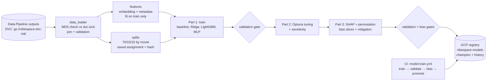

# VibeSpace Model-Pipeline: Movie DNA predictor

Model 1 of VibeSpace turns a movie's **plot embedding + metadata** into **12 Movie DNA scores in [0, 1]**
(`energy, intensity, pace, humor, darkness, hopefulness, emotional_intensity, romance, suspense,
complexity, realism, inspiration`). This folder trains, tunes, explains and bias-checks that model on the
DVC-versioned outputs of [`../Data-Pipeline`](../Data-Pipeline/README.md), pushes the selected model to a
model registry on Google Cloud with champion protection and rollback, and runs the whole sequence in CI.
Owner: VibeSpace team.

Course mapping (every guideline item → files, tests, evidence):
[`docs/requirements_checklist.md`](docs/requirements_checklist.md).

## Contents

1. [Overview](#1-overview)
2. [Prerequisites](#2-prerequisites)
3. [Setup](#3-setup)
4. [Folder structure](#4-folder-structure)
5. [Running the pipeline (all CLI commands)](#5-running-the-pipeline-all-cli-commands)
6. [Docker](#6-docker)
7. [MLflow tracking and UI](#7-mlflow-tracking-and-ui)
8. [Data loading and versioning](#8-data-loading-and-versioning)
9. [Features](#9-features)
10. [Split](#10-split)
11. [Models](#11-models)
12. [Validation gate](#12-validation-gate)
13. [Hyperparameter tuning](#13-hyperparameter-tuning)
14. [Hyperparameter sensitivity](#14-hyperparameter-sensitivity)
15. [Feature importance](#15-feature-importance)
16. [Bias detection and mitigation](#16-bias-detection-and-mitigation)
17. [Final selection](#17-final-selection)
18. [Model registry on GCP (champion protection, rollback)](#18-model-registry-on-gcp-champion-protection-rollback)
19. [CI/CD](#19-cicd)
20. [Results](#20-results)
21. [Testing](#21-testing)
22. [Configuration](#22-configuration)
23. [Known limitations](#23-known-limitations)

---

## 1. Overview



- Multi-output regression; metrics are MAE, RMSE, R² and Spearman (per dimension and averaged).
- **No LLMs.** The only pretrained model is the sentence-transformer encoder (`all-MiniLM-L6-v2`) that the
  data pipeline already used to produce the plot embeddings.
- **The Tag Genome is never a model input**: it is only the source of the 12 labels. A leakage guard fails
  the run if a genome, relevance, raw-DNA or label column reaches the features.
- Everything runs on CPU with fixed seeds (`random_seed: 42`). Selection uses the validation split only;
  the test split is used after each decision, for reporting.

## 2. Prerequisites

| Requirement | Notes |
|---|---|
| Python **3.11** | `python3.11 --version` |
| Data pipeline data | `Data-Pipeline/data/processed/` pulled with DVC (section 3) |
| macOS only: `libomp` | `brew install libomp` (LightGBM links to it; see the OpenMP note in section 23) |
| Google Cloud CLI | for `dvc pull` from the private bucket and for the registry commands |
| Docker Desktop | optional: container run, MLflow UI service, local workflow runs with `act` |
| Disk | about 3 GB for the venv, plus the data pipeline's data |

## 3. Setup

```bash
# 1. data: with the data pipeline's environment (see Data-Pipeline/README.md, sections 5 and 12)
cd VibeSpace/Data-Pipeline
python3.11 -m venv .venv
.venv/bin/pip install -r requirements-dev.txt \
    --constraint https://raw.githubusercontent.com/apache/airflow/constraints-2.10.5/constraints-3.11.txt
.venv/bin/pip install "dvc[gs]==3.59.1" \
    --constraint https://raw.githubusercontent.com/apache/airflow/constraints-2.10.5/constraints-3.11.txt
gcloud auth application-default login      # Google account with access to the bucket
.venv/bin/dvc pull                         # then `.venv/bin/dvc status` must say "up to date"

# 2. model environment (separate venv, no Airflow constraints)
cd ../Model-Pipeline
python3.11 -m venv .venv
.venv/bin/pip install -r requirements-dev.txt
.venv/bin/pip install -e . --no-deps       # makes `vibespace_model` importable (CLI and tests)
.venv/bin/python -m pytest                 # 195 offline tests, no data needed
```

Never install `dvc[gs]` without the constraints file: pip would upgrade shared packages and break Great
Expectations and DVC in the data pipeline's venv. Without bucket access, rebuild the same data by running the
data pipeline (`Data-Pipeline/README.md`, section 17); the hash check then tells you whether it matches the
committed `dvc.lock`. The tests never need the real data.

## 4. Folder structure

```text
Model-Pipeline/
├── src/vibespace_model/
│   ├── config.py           # YAML config + environment overrides, DNA dimension names
│   ├── errors.py           # error types (mapped to CLI exit codes)
│   ├── data_loader.py      # load + verify pipeline outputs (DVC MD5s), join, validation, data version
│   ├── features.py         # feature matrix, feature groups, leakage guard
│   ├── splits.py           # stratified 70/15/15 split by movie, saved assignment + hash, test guard
│   ├── models/             # base.py (interface), baseline.py, ridge.py, lightgbm_model.py, mlp.py
│   ├── train.py            # Part 1: shared data preparation + training of all candidates
│   ├── evaluate.py         # metrics, comparison tables, plots
│   ├── select.py           # selection, validation gate, final selection with the bias gate, model card
│   ├── tracking.py         # local MLflow (SQLite) runs, pyfunc wrapper, local registry + aliases
│   ├── tuning.py           # Part 2: Optuna search spaces, objective, studies (SQLite, resumable)
│   ├── sensitivity.py      # Part 2: fANOVA importance, one-at-a-time sweeps
│   ├── explain.py          # Part 3: SHAP per family, grouping, permutation importance by group
│   ├── bias.py             # Part 3: Fairlearn slice metrics, bias gate, bootstrap CI, mitigation helpers
│   ├── workflows.py        # orchestration of Parts 2 and 3 (tune, sensitivity, explain, bias)
│   ├── registry.py         # Part 4: bundles + checksums, GCP / local backends, champion, protected store
│   ├── promote.py          # Part 4: champion / challenger rule, promote, rollback, MLflow alias mirror
│   ├── registry_cli.py     # Part 4: push, pull, champion, promote, rollback, list-versions, protect
│   ├── ci_run.py           # Part 5: CI sequence train -> validate -> bias -> promote, job summary
│   ├── runtime.py          # macOS: one OpenMP runtime for LightGBM + PyTorch (section 23)
│   ├── pytest_openmp.py    # the same, as a pytest plugin
│   └── cli.py              # command-line entry point
├── configs/                # model_config.yaml (incl. registry + ci sections), tuning.yaml, bias.yaml
├── ci/notify.py            # Part 5: notification / Slack message builder, "not promoted" annotation
├── infra/                  # Part 4: gcp_setup.sh (idempotent GCP setup) + README (resources, roles, cost)
├── tests/                  # unit + integration tests; fixtures/build_fixtures.py writes synthetic data
├── reports/                # full-run reports: part1/, part2/, part3/ (sample runs: reports/sample/, ignored)
├── docs/                   # requirements_checklist, tuning, sensitivity, explainability, bias, ci_setup_for_later
├── artifacts/              # saved models, split, Optuna studies (git-ignored)
├── mlflow/                 # local MLflow SQLite store + artifacts (git-ignored)
├── Dockerfile, docker-compose.yaml, .dockerignore
├── requirements.txt (pinned), requirements-dev.txt
└── pyproject.toml, pytest.ini, ruff.toml, .gitignore
```

The two workflow files live at the repository root in `.github/workflows/` (`model-ci.yml`,
`model-train.yml`).

## 5. Running the pipeline (all CLI commands)

All commands run from `Model-Pipeline/`:

```bash
.venv/bin/python -m vibespace_model.cli <command> --config configs/model_config.yaml [options]
```

| Command | Part | What it does |
|---|---|---|
| `train` | 1 | load + verify data, create the split, train the 4 candidates, select, validation gate, register `candidate` |
| `evaluate` | 1 | re-evaluate the saved Part 1 models on validation (no training) |
| `select` | 1–3 | re-check the gates of the latest stage (`--stage part1\|part2\|part3`) |
| `tune` | 2 | Optuna search, retrain best configs, compare with defaults, select, gate, register `candidate` |
| `sensitivity` | 2 | fANOVA importance + one-at-a-time sweeps for the final candidate |
| `explain` | 3 | grouped SHAP + permutation importance by group |
| `bias` | 3 | slice metrics, bias gate, mitigation, final selection, test report, register `champion-candidate` |
| `run-all` | 1–3 | all of the above in order |
| `push` | 4 | upload a bundle to the registry without changing the champion |
| `pull` | 4 | download + verify a version (default: champion); falls back to the protected champion store |
| `champion` | 4 | show `champion.json` and the champion history |
| `list-versions` | 4 | all versions with status, plus the protected champion versions |
| `promote` | 4 | bundle + push + champion rule (default bundle: `artifacts/part3/final_model`) |
| `rollback` | 4 | champion back to the previous one (or `--to-version`), after a checksum check |
| `protect` | 4 | copy past champions into the protected store (`--version` for one, default: whole history) |
| `ci-run` | 5 | CI sequence `train → validate → bias → promote` (`--ci-step` for one step, `--out` folder) |

Options: `--sample-size N` (random subset; outputs go to `reports/sample/` and `artifacts/sample/`),
`--skip-hash-check` (fixture data only), `--tuned-params reports/part2/best_params.json` (reuse tuned
parameters instead of searching; sensitivity is then skipped), `--dry-run` (registry and CI commands: a local
folder `artifacts/registry-dry-run/` instead of GCP), `--bundle`, `--version`, `--to-version`, `--dest`,
`--local-alias`, `--tuning-config`, `--bias-config`, `--log-level`.

**Exit codes:** `0` ok (for `promote` / `ci-run` this includes "not promoted"), `1` validation gate failed,
`2` bias gate failed (final model flagged), `3` data, configuration or registry error (e.g. hash mismatch).
`run-all` continues past a failed gate and returns the final code.

Typical wall times on a 10-core laptop (CPU): `train` ≈ 1 min, `tune` ≈ 58 min (90 min cap),
`sensitivity` ≈ 1 min for the MLP, `explain` ≈ 2.5 min, `bias` < 1 min, `ci-run` ≈ 35 s.

## 6. Docker

```bash
docker compose build
GIT_COMMIT=$(git rev-parse HEAD) docker compose run --rm trainer train --config configs/model_config.yaml
GIT_COMMIT=$(git rev-parse HEAD) docker compose run --rm trainer run-all --config configs/model_config.yaml \
    --tuned-params /app/Model-Pipeline/reports/part2/best_params.json
docker compose down
```

- Image: `python:3.11-slim`, CPU-only PyTorch, pinned requirements, non-root user `vibespace`.
- The `trainer` service mounts `../Data-Pipeline/data` and `../Data-Pipeline/dvc.lock` **read-only** (so the
  hash check runs in the container too), the host `reports/` read-only (for `best_params.json`), and writes
  everything to `./docker-out/` (git-ignored), never to the host's `reports/`, `artifacts/` or `mlflow/`.
- `GIT_COMMIT` records the commit in the data version (the image has no `.git`).
- The full Optuna search is not repeated in Docker: `--tuned-params` reuses the Part 2 parameters.
- The image is published as `us-east1-docker.pkg.dev/vibespace-mlops/vibespace-images/trainer:<short sha>`
  and `:latest` (by hand in Part 4, by the `trainer image` CI job on `main`).
- Container vs macOS results: same split, same selections at every stage, identical LightGBM / Ridge /
  baseline metrics; the MLP differs by at most 3.6e-5 validation MAE (PyTorch's Linux and macOS CPU kernels
  round differently). Tolerance used for comparisons: 1e-3 absolute MAE.

## 7. MLflow tracking and UI

- Store: `mlflow/mlflow.db` (SQLite) + `mlflow/artifacts/`, experiment `vibespace-movie-dna`.
- Each command opens a parent run (`part1-train`, `part2-tune`, `part2-sensitivity`, `part3-explain`,
  `part3-bias`, `ci-train`) with nested runs per candidate, per Optuna trial and per bias experiment. Runs
  carry the split hash, data version id, mapping version, hash-check status and Git commit as tags; reports
  and plots are logged as artifacts.
- Local registry `vibespace-movie-dna`: Parts 1–2 register versions with alias `candidate`, Part 3 the final
  model with alias `champion-candidate`, `ci-run` with alias `ci-candidate`; the GCP champion is mirrored as
  alias `champion` (tag `gcp_registry_version`). Each version is an MLflow pyfunc wrapping the saved bundle
  (model + preprocessing + model card) that predicts from catalog columns plus `emb_000..emb_383`.

```bash
.venv/bin/mlflow ui --backend-store-uri sqlite:///mlflow/mlflow.db --port 5001     # host runs
docker compose up -d mlflow                                                          # container runs (docker-out/)
MLFLOW_PORT=5001 docker compose up -d mlflow    # if port 5000 is taken (macOS AirPlay Receiver uses it)
```

## 8. Data loading and versioning

`data_loader.py` reads the four outputs of the data pipeline from `Data-Pipeline/data/processed/`:

| File | Content |
|---|---|
| `movies_clean.parquet` | 13,666 movies: metadata, slice columns (`language_group`, `era`, `primary_genre`, `popularity_bucket`), quality flags |
| `movie_dna_labels.parquet` | 13,816 movies: the 12 labels, 12 `*_raw` genome scores (never used), `mapping_version` (`v1`) |
| `plot_embeddings.npy` + `plot_embeddings_index.parquet` | 13,666 × 384 `all-MiniLM-L6-v2` vectors and the row → movieId index |

1. **Hash check:** each file's MD5 is compared with its `outs` entry in `Data-Pipeline/dvc.lock`; directory
   outputs are hashed the way DVC does (MD5 of the sorted JSON listing, `.dir` suffix; verified against all 7
   directory outputs of the real `dvc.lock`). A mismatch or a missing file stops the run (exit code 3).
2. **Validation:** 12 labels present, numeric, without gaps and in [0, 1]; no duplicate movieIds; embedding
   width 384; index `row` is 0..n-1 in order and matches the matrix length; finite embeddings.
3. **Leakage guard:** columns that look like genome tags, relevance scores, raw DNA scores, labels or the
   mapping version are rejected in the catalog and in the feature names.
4. **Join** on `movieId`: labels ∩ catalog ∩ embeddings. Real run: 13,816 labelled → −150 without a catalog
   row (TMDB join / cleaning) → −0 without an embedding → **13,666 movies**. Movies without an embedding would
   be excluded and logged, never zero-filled.
5. **Data version** recorded for every run (model card + MLflow tags): the four `dvc.lock` hashes, a short
   `data_version_id`, `mapping_version`, encoder name, Git commit and whether the working tree was dirty.

Schema notes: there is no `runtime_filled` or `overview_short` column in the catalog; the model derives the
runtime fill itself (`runtime` + `flag_missing_runtime`) and uses `flag_short_overview`. The catalog also has
a `year_raw` column (raw release year), which is metadata, not a genome score.

## 9. Features

421 features in 7 groups:

| Group | Features | Notes |
|---|---|---|
| `plot_embedding` | `emb_000` … `emb_383` | as produced by the data pipeline |
| `genres` | `genre=<name>` multi-hot (20 genres in train, incl. `film_noir`) | vocabulary from train; unseen genres ignored |
| `runtime` | `runtime_scaled` | invalid / missing runtime → train median, clipped to train 1st–99th percentile, standardised |
| `year` | `release_year_scaled`, `release_year_missing` | missing → train median + flag |
| `language` | `language=<group>` one-hot | train categories; unseen → all zeros |
| `popularity` | `log1p_popularity`, `log1p_vote_count`, `vote_average_scaled` | log1p (counts), standardised |
| `flags` | `flag_short_overview`, `flag_missing_overview`, `flag_missing_runtime`, `flag_runtime_outlier`, `flag_year_mismatch`, `flag_unknown_language` | known at prediction time |

All statistics are fitted on the **training split only** and saved with the model as JSON
(`features.json`). `era`, `primary_genre` and `popularity_bucket` are slice columns for the bias analysis,
not features (they are coarse copies of year, genres and popularity). Nothing derived from the labels or the
Tag Genome (e.g. "has genome") is used.

## 10. Split

`splits.py`: 70/15/15 **by movie**, seed 42, stratified on `language_group`. Strata with fewer than 20 movies
(`indian_regional`, `unknown`) are merged into one `_small` stratum so the split never fails. The assignment
(`artifacts/split/split_assignment.csv`) and its SHA-256 hash are saved; `tune`, `sensitivity`, `explain`
and `bias` reload and verify exactly this split. CI recreates the deterministic split and checks it against
`ci.expected_split_hash`.

Real split: train 9,565 / validation 2,050 / test 2,051 (hash `30100836287cbcfc…`).

| `language_group` | train | val | test |
|---|---|---|---|
| english | 7,927 | 1,699 | 1,699 |
| other_international | 1,576 | 338 | 338 |
| hindi | 53 | 11 | 12 |
| indian_regional | 7 | 1 | 1 |
| unknown | 2 | 1 | 1 |

## 11. Models

Common interface (`models/base.py`): `fit(X, Y, X_val, Y_val, sample_weight, epoch_callback)`, `predict`
(always clipped to [0, 1]), `save`, `load`, `get_params`.

| Model | Details |
|---|---|
| Mean baseline | training mean of each dimension |
| Ridge | scikit-learn multi-output Ridge (`alpha`) |
| LightGBM | one regressor per dimension, L1 metric for early stopping on validation (50 rounds), deterministic, seed 42 |
| MLP (PyTorch, CPU) | input → hidden layers (default 256 → 128, tuned 512 → 256) → 12, ReLU, dropout, sigmoid outputs, Huber loss, Adam, early stopping on validation loss (best weights restored), fixed seeds and threads |

## 12. Validation gate

`select.validation_gate` (also used by CI): the model's mean validation MAE must be at least **15% lower than
the mean baseline's**, and its mean validation R² must be **≥ 0.30**. The result (pass/fail with reasons and
the numbers) is stored in the model card and in MLflow. The thresholds stayed at the defaults: the real
results clear them comfortably (Part 1: 34.5% and R² 0.503; final model: 38.5% and R² 0.513).

## 13. Hyperparameter tuning

Optuna, TPE sampler (seed 42), MedianPruner on the MLP's per-epoch validation MAE, objective = mean
validation MAE on the saved split; only train and validation rows reach the objective (asserted in code and
tests). Budgets: Ridge 25, LightGBM 50, MLP 40 trials; total cap 90 min (per model 5 / 55 / 30 min). Studies
live in `artifacts/part2/optuna/optuna.db` and resume after an interruption; every trial is a nested MLflow
run. Search spaces, results and the selection reasoning: [`docs/tuning.md`](docs/tuning.md).

Real run (57.9 min): Ridge 25 trials (best 0.1720), LightGBM 24 trials before its 55 min cap (best 0.1627),
MLP 40 trials, 19 pruned (best **0.1541**). Best parameters: `reports/part2/best_params.json`; plots
(optimisation history, parameter importance, parallel coordinates, default vs tuned) in `reports/part2/`.

## 14. Hyperparameter sensitivity

fANOVA importance per tuned model, plus one-at-a-time sweeps of the final candidate's 3 most important
hyperparameters ([`docs/sensitivity.md`](docs/sensitivity.md)). For the tuned MLP, `weight_decay` dominates
(importance 0.38; validation MAE 0.1541 at 2.9e-6, collapsing to the baseline's 0.2508 at ≥ 1.5e-3);
`hidden_sizes` (spread 0.0017) and `huber_delta` (0.0038) matter little. For LightGBM the learning rate
matters most (importance 0.27).

## 15. Feature importance

Two complementary methods on the final model (tuned MLP) and the next-best family (tuned LightGBM),
[`docs/explainability.md`](docs/explainability.md):

**Permutation importance by group (the measure to quote for group importance).** All columns of a group are
shuffled together on the validation set (5 repeats) and the increase in validation MAE is recorded. Tuned MLP
(validation MAE 0.1541):

| Group | MAE increase when shuffled |
|---|---|
| genres | **+0.0765** |
| popularity | +0.0417 |
| plot_embedding | +0.0193 |
| year | +0.0084 |
| language | +0.0046 |
| runtime | +0.0022 |
| flags | 0.0000 |

**Grouped SHAP** (MLP: GradientExplainer; LightGBM: TreeExplainer; Ridge: exact linear SHAP) on 1,000 test
movies with a training background, summing |SHAP| over each group's features. Tuned MLP shares:
plot_embedding 0.603, genres 0.226, popularity 0.109, year 0.028, language 0.022, runtime 0.012, flags 0.000.
**SHAP group sums favour the 384-dimensional embedding**: adding up |SHAP| over 384 correlated columns gives
that group a large total even when each column carries little unique information, while genres are 20
columns and runtime is one. SHAP is therefore used for *which* inputs matter per DNA dimension (humor leans
most on genres, 33% of its attribution; hopefulness and inspiration most on the plot text, 67–68%), and the
permutation test for *how much the model relies* on each group.

## 16. Bias detection and mitigation

Fairlearn `MetricFrame` per slice of `language_group`, `era`, `primary_genre`, `popularity_bucket` and
`flag_short_overview` (movie attributes only: there are no user demographics in MovieLens or the app). Gate:
slices with ≥ 30 movies must have MAE ≤ 1.25 × overall; smaller slices get a bootstrap 95% CI and are marked
"insufficient data" (e.g. Hindi, 11 films in validation). Mitigation experiments (re-weighting, re-sampling
of the training split) run on the final candidate's family. Details: [`docs/bias.md`](docs/bias.md) and
`reports/part3/bias_report.md`.

Result: every candidate passes; the tuned MLP's worst gated slice is `primary_genre=romance` (ratio 1.104 on
validation; `documentary` 1.148 on test). Re-weighting `primary_genre` lowers the worst ratio to 1.084 but
raises overall MAE by 4.2%; re-sampling costs 0.6% without narrowing the gap, so the unmitigated model is
kept. CI repeats the bias gate on every run and blocks the registry push when it fails.

## 17. Final selection

Best validation MAE among models passing **both** gates (unmitigated and mitigated variants of every tuned
family); if none passed the bias gate, the smallest-gap model passing the validation gate would be chosen and
flagged (exit code 2). Result: **tuned MLP**, not flagged. It is saved in `artifacts/part3/final_model/`
(model + `features.json` + `model_card.json` with both gates, the slice summary, SHAP top groups, data
version, split hash, parameters and metrics) and registered locally with alias `champion-candidate`.

## 18. Model registry on GCP (champion protection, rollback)

| What | Where |
|---|---|
| Model bundles | Artifact Registry **generic** repository `vibespace-models` (`us-east1`), package `movie-dna`, one version per bundle: `<version>.tar.gz` + `<version>.tar.gz.sha256`; cleanup keeps the latest 10 versions |
| Protected champions | package `movie-dna-champions` in the same repository + `champions/<version>.json` in the bucket: a copy of every version that has ever been champion, protected by a Keep cleanup rule (never deleted) |
| Metadata | bucket `gs://vibespace-model-registry-nsk` (private, versioned): `versions/<version>.json`, `champion.json`, `champion_history.jsonl` |
| Trainer image | Artifact Registry **Docker** repository `vibespace-images`: `…/vibespace-images/trainer:<short sha>` and `:latest` (keeps 3) |
| Setup | `infra/gcp_setup.sh` (idempotent) and [`infra/README.md`](infra/README.md) (resources, roles, cost ≈ $0.02–0.20 / month) |

- **Bundle:** the saved model folder, `features.json`, `model_card.json`, `metrics.json`, `bias_summary.json`,
  `split.json`, `data_version.json`, `manifest.json` (version, Git commit, MLflow run id, local registry
  version) and `checksums.sha256` (every member), plus the archive's own SHA-256 file. `pull` verifies both.
- **Version names:** `v<YYYYMMDD-HHMMSS>-<short git sha>` (UTC), e.g. `v20261115-005730-e63b305`.
- **Promotion rule:** a candidate becomes champion only if it passes the validation gate **and** the bias gate
  **and** its mean validation MAE is no worse than the champion's by more than **0.002**, both evaluated on the
  same split (the champion bundle is pulled and re-evaluated). Otherwise the champion stays ("not promoted
  (rollback)", recorded with reasons in the version metadata). With no champion, the first model passing both
  gates becomes champion.
- **Champion protection:** becoming champion (promote, rollback) copies the verified bundle to
  `movie-dna-champions` (idempotent). The repository's cleanup policy has a Keep rule for that package, and
  Keep rules always win over Delete rules, so past champions are never deleted even though every CI run adds
  a version. `pull` and `rollback` fall back to that package when a regular version was cleaned up.
- **Rollback:** `rollback` switches `champion.json` to the previous champion (or `--to-version`) after
  downloading it and verifying its checksums; every change is appended to `champion_history.jsonl`.
- **Local mirror:** the champion is mirrored as alias `champion` on the matching local MLflow version.
- **Keyless access:** CI uses the service account `vibespace-ci` through Workload Identity Federation (only
  `nikhilsk98/VibeSpace` may use it); no service-account keys exist.

```bash
.venv/bin/python -m vibespace_model.cli promote                 # Part 3 final model -> registry + champion rule
.venv/bin/python -m vibespace_model.cli champion                # champion.json + history
.venv/bin/python -m vibespace_model.cli list-versions           # versions + protected champions
.venv/bin/python -m vibespace_model.cli pull --dest /tmp/champion
.venv/bin/python -m vibespace_model.cli rollback [--to-version v…]
.venv/bin/python -m vibespace_model.cli protect                 # backfill the protected store from the history
.venv/bin/python -m vibespace_model.cli promote --dry-run       # same flow on artifacts/registry-dry-run/
```

Verified on GCP: the first champion `v20261115-005730-e63b305` (Part 3 final model) was pulled back from
Artifact Registry with valid checksums and predictions on 100 validation movies identical to the local model;
a deliberately worse TEST candidate (the mean baseline) was not promoted, a temporary switch was rolled back
correctly, and the test bundle was deleted (its two history entries, marked `TEST`, are kept as an audit
trail). Both champions promoted from a laptop (`v20261115-005730-e63b305`, `v20261115-011119-e63b305`) pull
back from the protected store with valid checksums. Every champion since then was promoted by CI and is
protected as well: `list-versions` shows 4 protected champions (section 20).

## 19. CI/CD

Two GitHub Actions workflows in `.github/workflows/` (repository root):

| Workflow | Triggers | What it does |
|---|---|---|
| `model-ci.yml` | pull request / push touching `Model-Pipeline/**` | Python 3.11 (pip cache), CPU PyTorch + requirements, `ruff check`, `ruff format --check`, full `pytest` with coverage (fails under 85%). No GCP, no secrets. |
| `model-train.yml` | push to `main`, `model-*`, `data-pipeline` touching `Model-Pipeline/**`, `Data-Pipeline/dvc.lock` or `Data-Pipeline/configs/**`; manual **Run workflow** with a `dry_run` input | job **train, gate and promote**: install (DVC in its own venv with the Airflow constraints; only the `dvc` executable is put on `PATH`, so every later step keeps the Model-Pipeline Python: fix from [PR #21](https://github.com/nikhilsk98/VibeSpace/pull/21)), Workload Identity login, `dvc pull` of the 4 processed files only, then `ci-run` steps **train** (tuned MLP from `ci.params`, no Optuna, split hash checked) → **validate** → **bias** → **promote**; "not promoted" warning, job summary, notification message, optional Slack, artifacts. Job **trainer image** (push to `main` only) builds and pushes the Docker image. |

- **Gates stop the run:** a failed validation or bias gate fails its step; the promote step is skipped, so
  nothing reaches the registry. Exit codes: 1 validation, 2 bias, 3 error.
- **"Not promoted" is a green run, but impossible to miss:** when the candidate passes both gates but is
  worse than the champion by more than 0.002, the job still succeeds (exit code 0: the pipeline worked, the
  model simply was not better). The run then shows a **warning annotation**
  `NOT PROMOTED: champion unchanged (rollback)` with the reasons (visible on the run page and the commit), the
  same line in bold at the **top of the job summary** followed by the reasons, and the same title in the
  notification message and Slack. Promotions and failed gates get their own headline (`PROMOTED: …`,
  `VALIDATION GATE FAILED …`, `BIAS GATE FAILED …`).
- **Auth:** keyless Workload Identity Federation (`google-github-actions/auth@v2`) with the repository
  variables `GCP_WORKLOAD_IDENTITY_PROVIDER` and `GCP_SERVICE_ACCOUNT`; permissions `contents: read`,
  `id-token: write`; one run per branch at a time (`concurrency`); 45 min timeout.
- **Notifications:** job summary on every run; the "Notification message" step prints the message for the
  event (`training_completed`, `validation_failed`, `bias_failed`, `promoted`, `not_promoted`,
  `pipeline_error`); the Slack step runs only when the secret `SLACK_WEBHOOK_URL` exists; GitHub's own
  emails cover failed runs.
- **Rollback in CI terms:** "not promoted" leaves the champion untouched; a manual `rollback` from a laptop
  restores any past champion (`docs/ci_setup_for_later.md`, section 5).
- **Why training runs directly in Python, not in the Docker image:** building the 2.7 GB image on a GitHub
  runner adds ≈ 6–8 min to every run, while the tuned MLP trains in seconds; the image is built in a separate
  job on `main` only and pushed to `vibespace-images`.
- **Under `act`** (`ACT` is set) the GCP, DVC and Slack steps are skipped: the run builds the synthetic
  fixture data, uses `--skip-hash-check --sample-size 200` and a dry-run registry.

Verified locally: actionlint (with shellcheck) 0 findings; `act` runs of `model-ci.yml` (182 tests then, all
passing in the Linux container) and `model-train.yml` (dry run: train → validate → bias → promote, artifacts
and summary); forced validation and bias failures stop at the right step with the promote step skipped; a
forced "not promoted" run stays green with the warning annotation and the summary banner; the real `ci-run`
against GCP retrained the tuned MLP on the fixed split and promoted it within tolerance (Δ validation MAE
0.00000).

```bash
.venv/bin/python -m vibespace_model.cli ci-run --dry-run                       # real data, local registry
.venv/bin/python -m vibespace_model.cli ci-run                                 # real data, GCP registry
VIBESPACE_MODEL_OVERRIDES='{"gate": {"min_r2": 0.99}}' .venv/bin/python -m vibespace_model.cli ci-run --dry-run  # force a gate failure
actionlint .github/workflows/*.yml                                             # from the repository root
act pull_request -W .github/workflows/model-ci.yml -P ubuntu-latest=catthehacker/ubuntu:act-latest
act workflow_dispatch -W .github/workflows/model-train.yml --input dry_run=true \
    -P ubuntu-latest=catthehacker/ubuntu:act-latest --artifact-server-path /tmp/act-artifacts
```

**Running on GitHub:** the repository variables `GCP_WORKLOAD_IDENTITY_PROVIDER` and `GCP_SERVICE_ACCOUNT`
are set (one-time setup, recorded in [`docs/ci_setup_for_later.md`](docs/ci_setup_for_later.md)).
`model-train` ran successfully on `main` ([run 43800488718](https://github.com/nikhilsk98/VibeSpace/actions/runs/43800488718)):
Workload Identity login, `dvc pull`, train, validation gate passed (MAE 38.5% lower than the baseline,
R² 0.513), bias gate passed (worst gated slice `primary_genre=romance`, 1.102 × overall), promotion of
`v20261116-035311-46abd39` within tolerance, and the trainer image pushed as `trainer:46abd39` and `:latest`
(train job 3 min 45 s, image job 3 min 38 s). `model-ci` passes on pull requests and on `main` (≈ 7 min).
The first run on `main` failed at the train step because the DVC install step put the whole DVC venv on
`PATH`, so `python` could not import `vibespace_model`; [PR #21](https://github.com/nikhilsk98/VibeSpace/pull/21)
puts only the `dvc` executable on `PATH` (local `act` runs skip that step, which is why it only showed on
GitHub). The submitted state is tagged
[`model-pipeline-v1.0`](https://github.com/nikhilsk98/VibeSpace/tree/model-pipeline-v1.0/Model-Pipeline).

## 20. Results

Full data, 13,666 movies; validation decides, test reported once after the decision.

| Stage | Model | Val MAE | Val R² | Val Spearman | Test MAE | Test R² | Gates |
|---|---|---|---|---|---|---|---|
| Part 1 | mean baseline | 0.2508 | −0.001 | 0.000 | – | – | – |
| Part 1 | Ridge (α = 10) | 0.1721 | 0.465 | 0.681 | – | – | – |
| Part 1 | MLP (defaults) | 0.1692 | 0.462 | 0.671 | – | – | – |
| Part 1 | **LightGBM (defaults)** | **0.1643** | 0.503 | 0.703 | 0.1653 | 0.492 | validation ✔ |
| Part 2 | Ridge tuned | 0.1719 | 0.464 | 0.680 | – | – | – |
| Part 2 | LightGBM tuned | 0.1627 | 0.512 | 0.710 | – | – | – |
| Part 2 | **MLP tuned** | **0.1541** | 0.513 | 0.717 | 0.1563 | 0.500 | validation ✔ |
| Part 3 | **MLP tuned (final)** | **0.1541** | 0.513 | 0.717 | **0.1563** | **0.500** | validation ✔, bias ✔ |

Final model: 38.5% lower validation MAE than the mean baseline; test RMSE 0.2029, test Spearman 0.708. Test
MAE per dimension ranges from 0.136 (energy) to 0.180 (inspiration). Training times (CPU): tuned MLP 2.8 s,
default LightGBM 35 s, tuned LightGBM 309 s.

**Current champion (GCP):** `v20261116-035311-46abd39`, the tuned MLP retrained by `model-train` on `main`
([run 43800488718](https://github.com/nikhilsk98/VibeSpace/actions/runs/43800488718); validation MAE
0.15417, test MAE 0.15635; promoted within tolerance, 0.00003 worse than the previous champion
`v20261116-034810-ec4bd52`). Earlier champions, all now "superseded" and protected:
`v20261115-005730-e63b305` (Part 3 bundle), `v20261115-011119-e63b305` (first real `ci-run`, from a laptop)
and `v20261116-034810-ec4bd52` (first `model-train` run on GitHub, on `ml-integration`). Local MLflow: v1–v2
Part 1 LightGBM (the second from the reproducibility rerun), v3 Part 2 (`candidate`), v4 Part 3 final
(`champion-candidate`), v5 laptop `ci-run` model (`ci-candidate`; it still carries the local alias
`champion`, because models trained in GitHub Actions live in that run's temporary MLflow store, section 23).

Reproducibility: two Part 1 runs with seed 42 gave the same split hash and bit-identical metrics; Docker
matches within 3.6e-5 MAE (section 6).

## 21. Testing

```bash
.venv/bin/python -m pytest                       # all tests (offline, synthetic fixtures)
.venv/bin/python -m pytest --cov                 # with coverage of src/vibespace_model
.venv/bin/python -m pytest -m "not integration"  # unit tests only
.venv/bin/ruff check . && .venv/bin/ruff format --check .
```

Fixtures are written by [`tests/fixtures/build_fixtures.py`](tests/fixtures/build_fixtures.py) into a
temporary folder: 240 synthetic movies whose labels depend on the embedding and genres, a matching `dvc.lock`
with real MD5s, deliberate join drops, missing years, invalid runtimes and tiny slices, plus tiny model,
tuning, bias, registry and CI configs. No data or model files are committed.

| File | Covers |
|---|---|
| `test_config.py` | YAML loading, path resolution, env overrides, validation errors |
| `test_data_loader.py` | hash check (happy path, mismatch, missing file, lock problems), DVC directory hash, duplicates, label range, embedding shape / order / NaN, leakage guard, join counts, sampling, Git info |
| `test_features.py` | shapes, groups, train-only fitting, missing year, invalid runtime, unseen categories, save/load, leakage guard |
| `test_splits.py` | determinism, disjointness, ratios, strata, merged small strata, save/reload, tampering, test guard |
| `test_models.py` | every model: shapes, [0, 1], save/load identity, seed reproducibility; early stopping, callbacks, weights |
| `test_evaluate.py`, `test_select.py` | metrics vs hand-computed values, tables, plots; selection, tie-break, gates, final selection branches, bundle, model card |
| `test_tracking.py` | MLflow logging to a temporary store, nested runs, registration + aliases, pyfunc prediction |
| `test_cli.py` | commands, exit codes 0 / 1 / 3, `--sample-size`, `--skip-hash-check` |
| `test_tuning.py`, `test_sensitivity.py` | search-space parsing, objective, determinism, pruning, trial logging, resume, caps, sweeps |
| `test_explain.py`, `test_bias.py` | SHAP grouping and additivity, explainers, permutation importance, slice metrics with a built-in gap, gate logic, bootstrap CI, re-weighting, re-sampling |
| `test_part{1,2,3}_integration.py` | each part end to end on fixtures; `run-all` registers `champion-candidate`; "none pass the bias gate" branch |
| `test_registry.py` | bundle create / verify (archive and member checksum mismatch), version naming, push / pull round trip, champion + history, local backend, gcloud command construction with a fake runner |
| `test_promote.py` | promotion rule (better, within tolerance, worse, failed gates, no champion), dry-run flow promote → worse candidate not promoted → rollback (previous, specific, missing, corrupted), MLflow alias mirroring, registry CLI |
| `test_champion_store.py` | champion copy on promotion, idempotency, cleanup simulation (champions never deleted), rollback to a cleaned-up champion, corrupted protected copy, backfill without TEST entries |
| `test_ci_run.py`, `test_notify.py` | `ci-run` sequencing and exit codes (validation / bias failure block the registry, promote guard, "not promoted" visible with exit 0), overrides, dry-run never calls gcloud; notification payloads, warning annotation, no-op without a webhook, post to a local fake server |

Current status: **195 tests pass** (Parts 1–3: 139, Part 4: 33, Part 5: 23), coverage **98%** of
`src/vibespace_model`, ruff clean, actionlint clean.

## 22. Configuration

| File | Sections |
|---|---|
| `configs/model_config.yaml` | paths, data files + hash-checked files, targets, features, split, slices, model defaults, explain, gate, `registry` (project, repositories, packages incl. `champion_package`, bucket, promotion tolerance, dry-run folder), `ci` (family, tuned params, expected split hash, local alias) |
| `configs/tuning.yaml` | sampler, pruner, budgets and time caps, search spaces, sensitivity settings |
| `configs/bias.yaml` | slice columns, gate (size, ratio), bootstrap, mitigation |

Relative paths resolve against `Model-Pipeline/`. Environment overrides: `RANDOM_SEED`,
`VIBESPACE_MODEL_PROCESSED_DIR`, `VIBESPACE_MODEL_DATA_PIPELINE_DIR`, `VIBESPACE_MODEL_REPORTS_DIR`,
`VIBESPACE_MODEL_ARTIFACTS_DIR`, `VIBESPACE_MODEL_MLFLOW_DIR`, `GIT_COMMIT`, and `VIBESPACE_MODEL_OVERRIDES`
(JSON deep-merged into the config; keys `tuning` / `bias` go into those files; used to test CI failure paths).

## 23. Known limitations

- **Small language slices:** Hindi (11–12 films per evaluation split) and Indian regional films (1 per split)
  cannot be gated or judged reliably; this comes from the Tag Genome's coverage (see the data pipeline's
  bias report). More labelled films for these groups is the real fix.
- **LightGBM tuning:** its best `learning_rate` (0.0100) sits at the **bottom of its search range**
  (0.01–0.2), and the search stopped at its time cap after 24 of 50 trials; a wider range with more trees
  might improve LightGBM slightly (at a large time cost; the MLP is ahead by 5%).
- **Validation is used twice** (early stopping and the tuning objective), so validation scores are slightly
  optimistic; the test scores (MAE 0.1563 vs 0.1541) show the effect is small.
- **macOS OpenMP:** the pip wheels of PyTorch and LightGBM each bring an OpenMP runtime, and two runtimes in
  one process hang or crash. The CLI and the test suite therefore restart themselves once on macOS with
  `DYLD_LIBRARY_PATH` pointing at PyTorch's `libomp` (`runtime.py`, `pytest_openmp.py`); importing both
  libraries in your own macOS script needs the same environment variable. Linux / Docker is unaffected.
- **Port 5000** is used by AirPlay Receiver on macOS; use `MLFLOW_PORT=5001` (compose) or `--port 5001`.
- **Registry consistency:** the GCP registry is the source of truth; the local MLflow alias `champion` is a
  mirror and is only moved when the matching version exists in the local store (a model trained in CI lives
  in that run's temporary MLflow store).
- **Identical retrains are promoted:** the rule allows "no worse by more than 0.002", so each successful CI
  run with unchanged data adds a version and becomes champion; the cleanup policy keeps the newest 10 regular
  versions and every champion is protected.
- **Local `act` runs do not cover the GCP steps:** under `act` the GCP, DVC and Slack steps are skipped
  (fixture data, dry-run registry), so problems in those steps only show on GitHub, as with the `PATH`
  problem fixed in [PR #21](https://github.com/nikhilsk98/VibeSpace/pull/21). The workflows now run on GitHub
  (section 19; setup record in `docs/ci_setup_for_later.md`).
- Only Model 1 (Movie DNA) is in scope; the ranker (Model 3) comes later.
