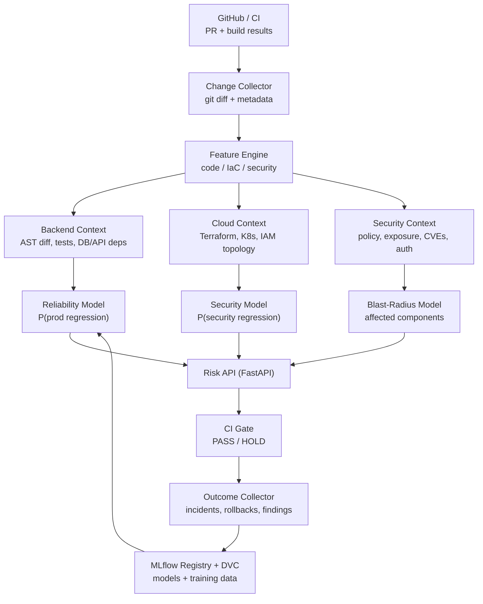

# ImpactAI

**Cross-layer change risk intelligence.** Predict what will break — and what could become insecure — before you deploy.

ImpactAI analyzes a proposed change (backend code + Terraform + Kubernetes + IAM + CI signals, together) and returns three calibrated predictions:

1. **Reliability risk** — P(production regression)
2. **Security risk** — P(security regression) + likely category
3. **Blast radius** — which downstream services and cloud resources are likely affected

> **Status: pre-alpha, week 0 of a 10-week build.** This is a graduate MLOps course project at Northeastern University. Models are trained on a *seeded microservice testbed*, not on production incident data from real organizations. Nothing here is validated for enterprise use. See [Limitations](#limitations).

---

## Why this exists

A single pull request can touch backend logic, a Helm value, an IAM policy, and a dependency version at once. Today those are reviewed by four different tools that never see each other's context:

- **Risk is siloed.** AppSec scanners, CI, cloud policy engines, and observability each see one slice.
- **Rules are not context.** `memory: 512Mi → 256Mi` is fine in one service and an outage in another, depending on traffic and dependents.
- **Outcomes are not learned.** Teams log incidents and rollbacks, but those labels never feed the next deployment decision.

ImpactAI treats the change as a single training sample across all layers, and closes the loop: post-deployment outcomes become new labels.

### How it's different from what exists

| Category | Examples | What they miss |
|---|---|---|
| Change-risk analytics | Digital.ai CRP | ITSM/delivery history only; not cross-layer backend + cloud + security |
| Infra change intelligence | ChangeGuard AI, DeployWhisper | Infrastructure-centric; little supervised *joint* security/reliability learning |
| AppSec / code security | GitHub Advanced Security, Snyk | Find issues; don't predict runtime reliability impact or service blast radius |
| **ImpactAI** | this repo | Joint change features → multi-task ML → dependency-aware blast radius |

The wedge is **learned cross-layer outcome prediction**, not another isolated scanner.

---

## How it works

```
COLLECT  →  PREDICT  →  EXPLAIN  →  LEARN
change +    risk +      drivers +   outcome →
context     blast       actions     retrain
            radius
```



| Component | Responsibility |
|---|---|
| **Change Collector** | Reads PR diff, CI results, repo metadata, IaC changes, deployment context |
| **Parsers** (backend / cloud / security) | Normalize heterogeneous changes into one versioned feature schema |
| **Dependency Graph** | Service calls, queues, databases, cloud resources, IAM edges, downstream consumers |
| **ImpactSense** | Multi-task model: reliability, security, blast radius → calibrated probabilities |
| **Risk API / CI Gate** | Publishes the report; optionally gates high-risk merges |
| **Outcome Collector** | Records actual deployment result, incidents, security findings, rollbacks |
| **MLflow + DVC** | Versions experiments, models, features, labels, datasets |

---

## Quickstart

### Prerequisites

- Docker Engine ≥ 24 and Docker Compose v2
- Python 3.11
- `kubectl` + a local cluster (kind or minikube) — only for the K8s scenarios
- Terraform ≥ 1.6 — only for the cloud scenario generator
- ~8 GB RAM free for the testbed

### Run the stack

```bash
git clone https://github.com/<org>/impactai.git
cd impactai

cp .env.example .env            # MLflow, Postgres, GitHub token for the CI gate
make up                         # docker compose up: testbed + MLflow + Postgres + Risk API
make seed                       # load service graph + runtime baselines
dvc pull                        # fetch versioned datasets (see docs/data.md for remote setup)
```

| Service | URL |
|---|---|
| Risk API (FastAPI + OpenAPI docs) | http://localhost:8000/docs |
| Dashboard | http://localhost:3000 |
| MLflow UI | http://localhost:5000 |
| Prometheus | http://localhost:9090 |

### Score a change

```bash
# From a local diff
impactai score --repo ./testbed/apps --base main --head feature/iam-widen

# From a GitHub PR
impactai score --pr 1842 --service payment-service
```

```
PR #1842 | payment-service

Reliability risk : 0.74  (HIGH)
Security risk    : 0.91  (CRITICAL)
Likely issue     : excessive_privilege
Affected         : payment, checkout, customer-data

Top drivers:
  +0.31  iam_wildcard_added         (s3:GetObject -> s3:*)
  +0.22  memory_request_delta       (-50%)
  +0.17  auth_path_modified         (token validation changed)

Contract: payment-service-change-risk -> CRITICAL -> block_release
Recommended: security review + load test + 5% canary
```

### Generate training data

```bash
make scenarios/backend    # retry removal, pool misconfig, slow query, timeout mismatch, ...
make scenarios/cloud      # IAM widening, 0.0.0.0/0, privileged containers, netpol deletion, ...
make label                # deploy, drive load, collect telemetry, write outcome labels
dvc repro                 # features -> train -> evaluate -> register
```

---

## Repository layout

```
impactai/
├── services/
│   ├── change_collector/      # diff + CI metadata ingestion
│   ├── feature_engine/        # parsers -> shared feature schema
│   ├── risk_api/              # FastAPI scoring + report endpoints
│   └── outcome_collector/     # post-deploy telemetry -> labels
├── impactsense/
│   ├── features/              # feature builders, schema v1 (frozen week 1)
│   ├── graph/                 # NetworkX dependency graph + graph features
│   ├── models/                # reliability, security, blast-radius trainers
│   ├── explain/               # SHAP + rule context
│   └── eval/                  # temporal splits, calibration, baselines
├── testbed/
│   ├── apps/                  # auth, checkout, payment, inventory, notification
│   ├── infra/                 # terraform/, k8s/, iam/
│   ├── scenarios/             # change library (YAML specs for injection)
│   └── load/                  # traffic profiles for label generation
├── contracts/                 # per-service risk contracts (YAML)
├── dashboard/                 # React + Recharts/D3
├── pipelines/                 # dvc.yaml, params.yaml, Optuna configs
├── .github/workflows/         # impactai-gate.yml, train.yml, ci.yml
└── docs/                      # schema, data card, eval protocol, runbooks
```

---

## The ML component (ImpactSense)

### Training data

Every seeded change produces one supervised row: normalized diff features + graph context + CI signals + pre-deployment runtime baselines → actual post-deployment outcome. Safe changes supply the negative class. Magnitudes and combinations are varied so the model cannot collapse to a single rule.

| Dataset | Use | Approx. size | Source |
|---|---|---|---|
| Seeded change dataset | Main risk + blast-radius training | 300–1,000 changes | Self-generated testbed |
| Deployment telemetry | Outcome labels, runtime features | Thousands of metric windows | Self-generated |
| NVD / CWE | Severity + weakness enrichment | Public feeds | NIST / MITRE |
| OWASP Benchmark | Security scenarios / eval | Public benchmark | OWASP |
| IaC rule examples | Misconfiguration scenario generation | Curated | Checkov / KICS style |
| Public Git histories *(optional)* | Change-metadata feature studies | Selected repos | GitHub |

Versions, licenses, and repo selection are confirmed in week 1 before anything enters DVC. See `docs/data_card.md`.

### Model design

| Aspect | Plan |
|---|---|
| **Input** | One row per change: backend + IaC + security + CI + historical + graph features |
| **Targets** | Reliability regression (binary); security regression + category (multi-label); affected components (multi-label); severity (optional) |
| **Baselines** | Logistic regression; a hand-written rule score. **Built before any model result is reported.** |
| **Main models** | XGBoost / LightGBM for risk; one-vs-rest + ranking for blast radius |
| **Graph** | Hand-built graph features first; GNN (PyTorch Geometric) is a stretch goal only |
| **Tuning** | Optuna; every trial and artifact logged to MLflow |
| **Metrics** | PR-AUC, recall, macro-F1, calibration (Brier / reliability curves); Precision@K, Recall@K for blast radius |
| **Splits** | Temporal split **plus** held-out unseen change *combinations* to catch leakage |
| **Serving** | Registered in MLflow, loaded by the Risk API |

### Change library

Backend (reliability):

| Change | Injection | Expected label |
|---|---|---|
| Retry regression | Remove/reduce retry on a transient dependency | Error-rate increase, downstream amplification |
| DB pool misconfig | Pool below peak demand | Queue buildup, timeouts, p95 regression |
| API contract change | Rename/remove a consumed response field | Integration failure downstream |
| Slow query | Indexed query → full scan | Latency increase, DB saturation |
| Timeout mismatch | Upstream timeout < dependency latency | Partial failures despite healthy downstream |
| Concurrency bug | Unsafe shared state / duplicate processing | Intermittent failures, duplicate writes |
| Auth middleware change | Alter token validation or authz path | Reliability and/or security regression |

Cloud / security:

| Change | Injection | Expected signal |
|---|---|---|
| IAM privilege expansion | `s3:GetObject` → `s3:*`, broad resource scope | Excessive privilege |
| Public exposure | Internal CIDR → `0.0.0.0/0` | Attack-surface increase |
| Privileged container | `privileged: false` → `true`, runAsRoot | Container escape risk |
| Resource reduction | `512Mi` → `256Mi`, replicas `4` → `1` | OOM / reduced redundancy |
| Network policy removal | Delete egress restriction | Lateral movement, exfiltration |
| TLS/auth weakening | Disable validation, relax auth | Security regression, possibly lower latency |
| Vulnerable dependency | Package/image with known severe CVE | Supply-chain risk |

The interesting cases are the crossings: a backend feature needs a new S3 permission, the IAM role is widened, and the service already has network reach to sensitive data. ImpactAI scores the combination, not each file alone.

---

## Risk contracts

A risk contract is a YAML file living next to the service code, reviewed like any other deployment policy.

```yaml
# contracts/payment-service.yaml
contract: payment-service-change-risk
target: payment-service
thresholds:
  reliability_risk: "< 0.40"
  security_risk: "< 0.25"
  max_blast_radius_services: 3
critical_categories:
  - public_exposure
  - privilege_escalation
actions:
  medium_risk:   [load_test, 10_percent_canary]
  high_risk:     [security_review, 5_percent_canary]
  critical:      [block_release]
evidence_required: [ci_passed, no_secret_findings]
```

Wire it into CI:

```yaml
# .github/workflows/impactai-gate.yml
- uses: ./.github/actions/impactai
  with:
    contract: contracts/payment-service.yaml
    api-url: ${{ secrets.IMPACTAI_URL }}
    mode: enforce        # or: report (comment only, never fails the build)
```

`report` is the default outside the demo. A probabilistic model should be decision support by default; blocking is an explicit, per-service opt-in.

---

## MLOps loop

- **MLflow** — experiment tracking, model registry, stage promotion (`Staging` → `Production`), artifact lineage
- **DVC** — versioned features, labels, and training sets; `dvc repro` reproduces any reported number
- **Evidently + Prometheus** — feature drift, prediction drift, and service telemetry
- **Outcome Collector** — every deployment writes `(prediction, actual)` pairs; these drive both monitoring and the next training set
- **Retraining trigger** — N new labeled outcomes *or* drift threshold breach → training run → eval gate vs. current production model → promotion only if it wins on held-out PR-AUC and calibration

---

## Evaluation targets

Targets for the end of the build, not results. Nothing below has been measured yet.

- [ ] ≥ 300 labeled change experiments across backend, cloud, and security scenarios
- [ ] Reliability model PR-AUC meaningfully above the rule and majority baselines
- [ ] Security model macro-F1 ≥ 0.75 on held-out scenario combinations
- [ ] Blast-radius Recall@3 ≥ 0.80 on the controlled service graph
- [ ] Live demo: a risky PR flagged/blocked, a safe PR passes
- [ ] Full stack reproducible from `docker compose up`; all models versioned in MLflow

---

## Roadmap

| Week | Milestone | Deliverable |
|---|---|---|
| 1–2 | Testbed + data schema | Microservices, Docker/K8s, MLflow + DVC, frozen change-event schema |
| 3 | Backend change generator | Reliability scenarios, CI metadata, runtime labels |
| 4 | Cloud/security generator | Terraform/K8s/IAM scenarios, security labels, scan enrichment |
| 5 | Feature + graph pipeline | Normalized feature vectors, dependency graph, versioned datasets |
| 6 | Baseline models | Logistic + rules; first XGBoost/LightGBM risk models |
| 7 | Blast radius + explainability | Affected-service model, SHAP, calibration |
| 8 | MLOps loop | Registry, monitoring, retraining trigger, promotion |
| 9 | Dashboard + CI gate | PR report, blast-radius graph, GitHub Actions demo |
| 10 | Evaluation + demo | Held-out experiments, final report, safe-vs-risky live demo |

### Known risks

| Risk | Mitigation |
|---|---|
| Not enough real labels | Controlled seeded testbed; claim is experimental prediction, not enterprise accuracy |
| Model learns trivial rules | Vary magnitudes, combine changes, hold out unseen combinations, always compare to rule-only baseline |
| Class imbalance | Class weighting, PR-AUC over accuracy, calibrated thresholds, balanced scenario generation |
| Graph scope explodes | Explicit service/resource edges only; GNN stays a stretch goal |
| 6-person integration drag | Freeze the change-event and feature schema in week 1; weekly integration day |

---

## Team

| Area | Owns |
|---|---|
| Backend / testbed | Microservices, change injection, runtime telemetry, reliability labels |
| Cloud / security | Terraform/K8s/IAM scenarios, security enrichment, security labels |
| Data / features | Change schema, parsers, feature engineering, DVC datasets |
| ML | Risk models, blast-radius model, tuning, explainability, evaluation |
| MLOps / CI | MLflow registry, monitoring, retraining, GitHub Actions gate |
| Platform / dashboard | FastAPI, PostgreSQL, dependency graph UI, reports, integration |

Everyone writes tests and owns the experiment design for their area.

## Contributing

1. The **change-event schema** (`impactsense/features/schema.py`) and the **feature contract** are frozen after week 1. Changes to either require a version bump and a note in `docs/schema.md` — downstream models and stored datasets depend on them.
2. Branch naming: `area/short-description` (e.g. `ml/blast-radius-ranking`).
3. Any PR touching model code must include the MLflow run URL in the description.
4. No reported metric without a baseline comparator in the same run.
5. `make lint test` must pass; `dvc repro` must still reproduce the pipeline.

---

## Limitations

Stated plainly, because this is a research prototype:

- **Labels are synthetic.** Outcomes come from a seeded testbed under scripted load, not production traffic. Generalization to real repositories is unmeasured.
- **The testbed is small.** Eight components and one service graph topology. Blast-radius numbers are bounded by that graph and will not transfer as-is.
- **Scenario injection is a confound.** Seeded changes are drawn from a known library, so the model may be learning the generator's distribution. The held-out unseen-combination split is the check on this, not a guarantee.
- **Probabilities are not verdicts.** Calibration is evaluated, but a 0.74 reliability risk is an estimate from a few hundred samples. Blocking on it is a demo behavior, not a recommendation.
- **Security coverage is categorical, not exhaustive.** ImpactAI predicts risk categories it has seen; it is not a substitute for a scanner, a pentest, or review.

## License

TBD — to be set before the repo goes public (week 1 decision alongside dataset licensing).
